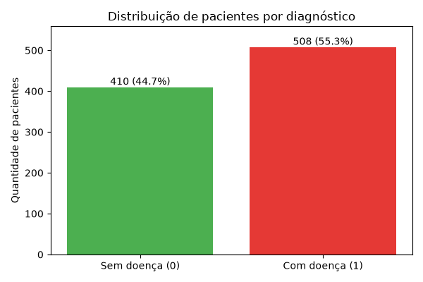
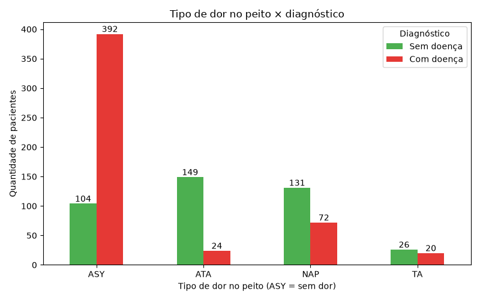
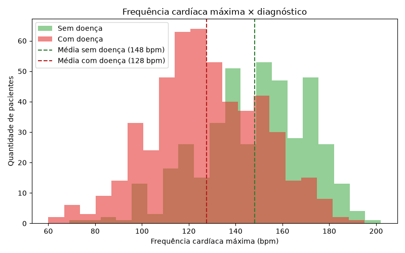
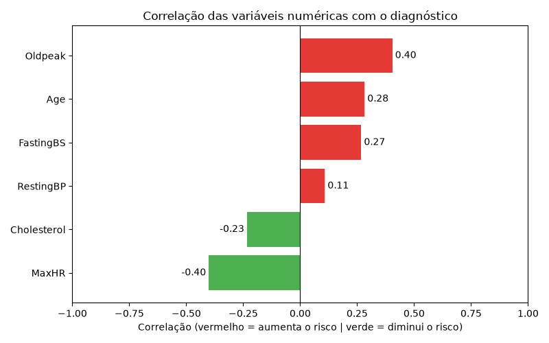
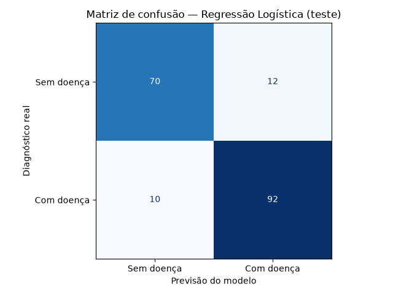
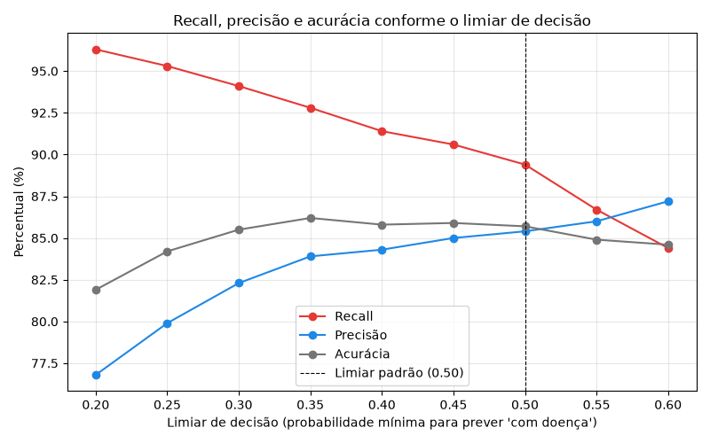
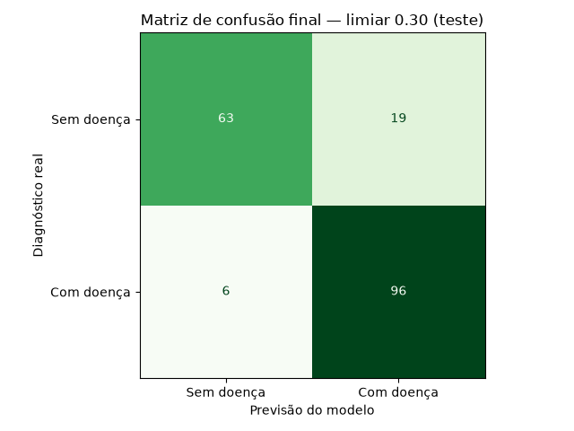
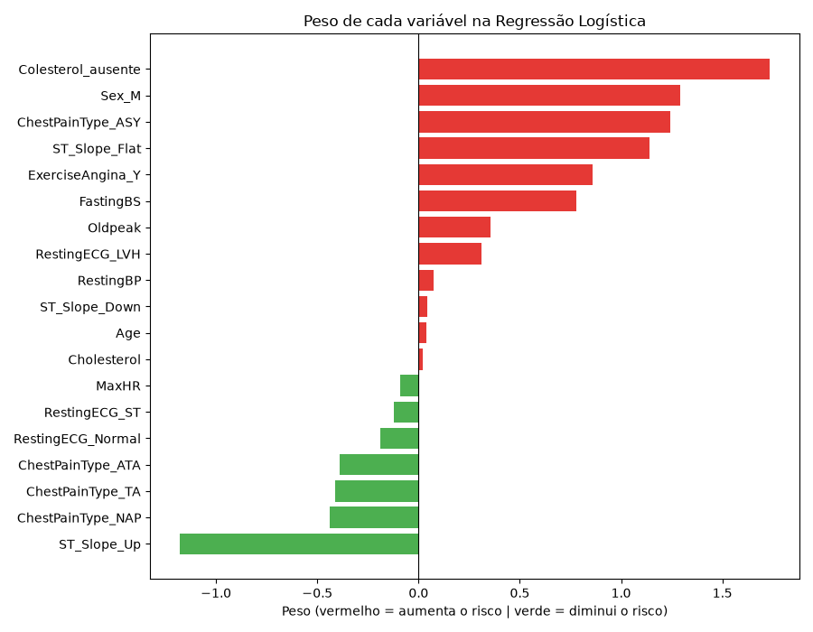

# Previsão de Risco de Doença Cardíaca com Machine Learning

Modelo de classificação que estima o risco de doença cardíaca a partir de dados clínicos, priorizando o **recall** para minimizar casos não detectados.

> ⚠️ **Aviso:** este é um projeto de estudo e portfólio. O modelo **não substitui avaliação nem diagnóstico médico** e não deve ser usado para decisões clínicas.

---

## Resumo do projeto

| | |
|---|---|
| **Problema** | Prever se um paciente tem risco de doença cardíaca a partir de 11 dados clínicos |
| **Dados** | [Heart Failure Prediction Dataset](https://www.kaggle.com/datasets/fedesoriano/heart-failure-prediction) — 918 pacientes, licença CC0 |
| **Modelo** | Regressão Logística com limiar de decisão ajustado para 30% |
| **Resultado** (pacientes nunca vistos pelo modelo) | **Recall de 94,1%** — encontra 96 de cada 102 doentes · Acurácia 86,4% · Precisão 83,5% |
| **Entrega** | API em FastAPI + interface web em HTML, CSS e JavaScript |
| **Online** | [cardio.sistemasdatabase.cloud/app](https://cardio.sistemasdatabase.cloud/app/) — teste no navegador |
| **Tecnologias** | Python · pandas · scikit-learn · matplotlib · FastAPI · Pydantic · Uvicorn · HTML/CSS/JS |

### Interface

O usuário preenche os dados do paciente em português (sem precisar conhecer siglas) e recebe a probabilidade estimada, a classificação de risco e uma barra mostrando a posição em relação ao limiar de 30%.


### Destaques técnicos

- **Prioridade ao recall:** em saúde, deixar um doente sem diagnóstico é o erro mais grave. O limiar de decisão foi reduzido de 50% para 30% (escolhido por validação cruzada, só com os dados de treino), cortando os doentes não detectados de 10 para 6 no teste, com acurácia praticamente igual.
- **Dados faltando disfarçados:** 172 registros tinham colesterol igual a 0. A investigação mostrou que 88% deles eram de pacientes doentes; em vez de só preencher, foi criada a variável `Colesterol_ausente` — que se tornou a mais forte do modelo.
- **Sem vazamento de dados:** mediana, padronização e escolha do limiar calculadas **somente com o treino**; o conjunto de teste foi usado uma única vez, na avaliação final.
- **Comparação honesta de modelos:** Regressão Logística e Random Forest empataram na validação cruzada; foi escolhido o modelo mais simples e explicável.
- **Esteira completa (`Pipeline`):** o modelo salvo recebe os dados no formato original e faz todo o tratamento sozinho, garantindo que a API aplique exatamente o que foi avaliado.

### Como executar

```bash
# Baixa o projeto e entra na pasta
git clone https://github.com/JussielsonGsilva/mml_preditivo_cardio.git
cd mml_preditivo_cardio

# Cria o ambiente virtual e instala as bibliotecas
python3 -m venv .venv
source .venv/bin/activate
pip install -r requirements.txt

# Liga a API e a interface
uvicorn api:app --reload
```

Depois, no navegador:

- **Interface:** http://127.0.0.1:8000/app
- **Documentação da API:** http://127.0.0.1:8000/docs

> O passo a passo completo — da análise exploratória à interface, com todos os comandos, saídas esperadas e decisões — está nas seções abaixo.

---

## Sumário

1. [Objetivo](#1-objetivo)
2. [Definição do problema](#2-definição-do-problema)
3. [Dataset](#3-dataset)
4. [Estrutura do projeto](#4-estrutura-do-projeto)
5. [Requisitos](#5-requisitos)
6. [Como reproduzir o projeto](#6-como-reproduzir-o-projeto)
7. [Etapas do projeto e andamento](#7-etapas-do-projeto-e-andamento)
8. [Tecnologias utilizadas](#8-tecnologias-utilizadas)
9. [Créditos e licença dos dados](#9-créditos-e-licença-dos-dados)

---

## 1. Objetivo

Construir, do zero e de forma documentada, um modelo de **machine learning preditivo** que receba dados clínicos de uma pessoa e informe:

- se há indício de doença cardíaca (**1 = sim**, **0 = não**);
- a **probabilidade** dessa previsão (ex: "78% de risco").

O projeto cobre o ciclo completo: obtenção dos dados, análise exploratória, preparação, treinamento, avaliação, explicação do modelo e disponibilização via API.

---

## 2. Definição do problema

| Item | Definição |
|---|---|
| Tipo de problema | Classificação binária (duas respostas possíveis) |
| Entrada | 11 variáveis clínicas (idade, sexo, pressão, colesterol etc.) |
| Saída | `0` (sem doença) ou `1` (com doença) + probabilidade |
| Variável-alvo | `HeartDisease` |
| Métrica principal | **Recall** |
| Métricas secundárias | Acurácia, precisão, F1-score, matriz de confusão |

### Por que o recall é a métrica principal?

Em saúde, o erro mais grave é dizer que uma pessoa está saudável quando ela tem a doença (**falso negativo**). O recall mede justamente quantos dos doentes reais o modelo conseguiu identificar:

```
Recall = doentes identificados corretamente / total de doentes reais
```

Um recall alto significa poucos casos de doença passando despercebidos.

---

## 3. Dataset

- **Nome:** Heart Failure Prediction Dataset
- **Fonte:** Kaggle — https://www.kaggle.com/datasets/fedesoriano/heart-failure-prediction
- **Autor:** fedesoriano (2021)
- **Licença:** CC0-1.0 (domínio público)
- **Tamanho:** 918 registros (pacientes) × 12 colunas (11 variáveis + alvo)
- **Origem:** junção de cinco bases clássicas de cardiologia (Cleveland, Hungarian, Switzerland, Long Beach VA e Stalog). Somavam 1.190 registros; após remover 272 duplicados, restaram 918.
- **Distribuição do alvo:** 508 com doença (1) e 410 sem doença (0) — classes relativamente equilibradas.

### Dicionário de dados

| Coluna | Descrição | Tipo / valores |
|---|---|---|
| `Age` | Idade do paciente | Número inteiro (anos) |
| `Sex` | Sexo | `M` = masculino, `F` = feminino |
| `ChestPainType` | Tipo de dor no peito | `TA` = angina típica (aperto no esforço, melhora com repouso), `ATA` = angina atípica (parecida com angina, sem o padrão clássico), `NAP` = dor não anginosa, `ASY` = assintomático |
| `RestingBP` | Pressão arterial em repouso | mm Hg |
| `Cholesterol` | Colesterol sérico | mg/dl |
| `FastingBS` | Glicemia em jejum | `1` se > 120 mg/dl, `0` caso contrário |
| `RestingECG` | Resultado do eletrocardiograma em repouso | `Normal`, `ST` (anormalidade na onda ST-T), `LVH` (hipertrofia ventricular esquerda) |
| `MaxHR` | Frequência cardíaca máxima atingida | Número entre 60 e 202 |
| `ExerciseAngina` | Angina induzida por exercício | `Y` = sim, `N` = não |
| `Oldpeak` | Depressão do segmento ST no exercício | Número decimal |
| `ST_Slope` | Inclinação do segmento ST no pico do exercício | `Up`, `Flat`, `Down` |
| `HeartDisease` | **Alvo** — presença de doença cardíaca | `1` = sim, `0` = não |
| `Colesterol_ausente` | **Coluna criada no projeto** (etapa 7) — indica se o colesterol estava faltando (zero) no dado original | `1` = estava faltando, `0` = valor real |

> O arquivo `heart.csv` deve ser baixado do Kaggle e colocado em `dados/heart.csv` (ver seção 6).

---

## 4. Estrutura do projeto

Estrutura atual (será atualizada a cada etapa):

```
mml_preditivo_cardio/
├── .venv/               # Ambiente virtual Python (não vai para o GitHub)
├── .gitignore           # Lista do que o Git ignora (.venv, CSVs gerados, cache)
├── requirements.txt     # Bibliotecas e versões exatas do projeto
├── dados/
│   ├── heart.csv            # Original do Kaggle (somente leitura, nunca alterado)
│   ├── heart_trabalho.csv   # Cópia de trabalho usada nos scripts
│   ├── treino.csv           # 80% dos pacientes (733) — usado para o modelo aprender
│   ├── teste.csv            # 20% dos pacientes (184) — usado só na avaliação final
│   ├── treino_tratado.csv   # Treino com colesterol tratado + coluna Colesterol_ausente
│   ├── teste_tratado.csv    # Teste com colesterol tratado (mediana do treino) + Colesterol_ausente
│   ├── treino_final.csv     # Treino 100% numérico (20 colunas), pronto para o modelo
│   ├── teste_final.csv      # Teste 100% numérico, mesmas colunas do treino
│   ├── treino_padronizado.csv  # Treino com colunas contínuas padronizadas (média 0, desvio 1)
│   └── teste_padronizado.csv   # Teste padronizado com a média e o desvio do treino
├── modelos/
│   └── modelo_cardio.joblib    # Esteira completa treinada + limiar 0,30 (usado pela API)
├── graficos/
│   ├── 01_distribuicao_alvo.png          # Pacientes com e sem doença
│   ├── 02_dor_peito_vs_diagnostico.png   # Tipo de dor no peito × diagnóstico
│   ├── 03_maxhr_vs_diagnostico.png       # Frequência cardíaca máxima × diagnóstico
│   ├── 04_correlacao_alvo.png            # Correlação das variáveis numéricas com o alvo
│   ├── 05_matriz_confusao.png            # Matriz de confusão da Regressão Logística no teste
│   ├── 06_limiar_decisao.png             # Recall, precisão e acurácia conforme o limiar
│   ├── 07_matriz_confusao_final.png      # Matriz de confusão final (limiar 0,30) no teste
│   ├── 08_pesos_modelo.png               # Peso de cada variável na Regressão Logística
│   └── 09_interface_web.png              # Print da interface web com resultado de risco alto
├── 01_ler_dados.py          # Etapa 5: leitura e primeira visão dos dados
├── 02_estatisticas.py       # Etapa 6: estatísticas e busca de valores impossíveis
├── 03_grafico_alvo.py       # Etapa 6: distribuição e balanceamento do alvo (com %)
├── 04_grafico_dor_peito.py  # Etapa 6: gráfico tipo de dor × diagnóstico
├── 05_grafico_maxhr.py      # Etapa 6: histograma da frequência cardíaca máxima
├── 06_grafico_correlacao.py # Etapa 6: correlação de cada variável numérica com o alvo
├── 07_investigar_colesterol.py # Etapa 6: investigação dos zeros do colesterol
├── 08_dividir_treino_teste.py  # Etapa 7: remove RestingBP = 0 e divide treino/teste
├── 09_tratar_colesterol.py     # Etapa 7: mediana do treino + coluna Colesterol_ausente
├── 10_codificar.py             # Etapa 7: one-hot encoding das colunas de texto
├── 11_padronizar.py            # Etapa 8: padronização (StandardScaler) das colunas contínuas
├── 12_regressao_logistica.py   # Etapa 8: treino e avaliação da Regressão Logística
├── 13_random_forest.py         # Etapa 8: Random Forest + comparação com a Regressão Logística
├── 14_validacao_cruzada.py     # Etapa 8: validação cruzada (5 rodadas) dos dois modelos
├── 15_matriz_confusao.py       # Etapa 9: matriz de confusão e métricas completas
├── 16_limiar_decisao.py        # Etapa 9: efeito do limiar de decisão (validação cruzada no treino)
├── 17_avaliacao_final.py       # Etapa 9: avaliação final no teste (limiar 0,50 × 0,30)
├── 18_explicar_modelo.py       # Etapa 9: pesos e razão de chances de cada variável
├── 19_salvar_modelo.py         # Etapa 10: monta a esteira completa, confere e salva o modelo
├── api.py                      # Etapa 10: API de previsões (FastAPI) + entrega da interface em /app
├── preprocessamento.py         # Etapa 10: classe TratadorColesterol (usada pelo modelo salvo e pela API)
├── web/                        # Etapa 12: interface web (servida pela API em /app)
│   ├── index.html              # Formulário com os 11 campos e área de resultado
│   ├── estilo.css              # Visual do formulário e do cartão de resultado
│   └── script.js               # Envia os dados para /prever e monta o cartão
└── README.md                # Este documento
```

---

## 5. Requisitos

- Linux (testado no Ubuntu)
- **Python 3.10 ou superior** (desenvolvido com Python 3.13)
- Pacote `python3-venv` instalado
- Conta gratuita no Kaggle (para baixar o dataset)

### Bibliotecas Python

| Biblioteca | Versão usada | Para que serve no projeto |
|---|---|---|
| pandas | 3.1.1 | Ler e manipular o CSV como tabela |
| scikit-learn | 1.9.1 | Modelos de ML, divisão treino/teste e métricas |
| matplotlib | 3.11.2 | Gráficos da análise e dos resultados |
| fastapi | 0.162.2 | Framework da API de previsões (rotas, validação e documentação automática) |
| uvicorn | 0.54.0 | Servidor que executa a API e recebe as requisições HTTP |
| pydantic | 2.14.3 | Validação dos dados do paciente (instalado junto com o FastAPI) |

---

## 6. Como reproduzir o projeto

Todos os comandos abaixo são executados **no terminal**, a partir da pasta onde você quer guardar o projeto.

### 6.0. Caminho rápido — clonar o repositório

Repositório: **https://github.com/JussielsonGsilva/mml_preditivo_cardio**

O repositório já contém todos os scripts, os gráficos, o dataset original (`dados/heart.csv`, licença CC0) e o **modelo treinado** (`modelos/modelo_cardio.joblib`, ~5,6 KB, pronto para a API). Basta clonar, criar o ambiente e instalar as bibliotecas:

```bash
# Baixa o projeto completo do GitHub
git clone https://github.com/JussielsonGsilva/mml_preditivo_cardio.git

# Entra na pasta do projeto
cd mml_preditivo_cardio

# Cria e ativa o ambiente virtual
python3 -m venv .venv
source .venv/bin/activate

# Instala as bibliotecas nas versões exatas do projeto
pip install -r requirements.txt
```

Depois disso, siga a partir da **seção 6.5**, executando os scripts na ordem (`01_...` até `18_...`). **Não pule a seção 6.7** (cópia de trabalho): a partir do script 03, os scripts leem `dados/heart_trabalho.csv`, que é criado nela. As seções 6.1 a 6.4 explicam como o projeto foi montado do zero e podem ser puladas por quem clonar o repositório.

> Os CSVs intermediários (`treino.csv`, `teste_final.csv` etc.) **não estão no repositório**: eles são recriados pelos scripts 08 a 11. Os arquivos ignorados pelo Git estão listados no `.gitignore`.

### 6.1. Criar a pasta do projeto e a pasta de dados

```bash
# Cria a pasta do projeto e a subpasta "dados"
mkdir -p mml_preditivo_cardio/dados

# Entra na pasta do projeto
cd mml_preditivo_cardio
```

### 6.2. Baixar o dataset

1. Acesse https://www.kaggle.com/datasets/fedesoriano/heart-failure-prediction e faça login.
2. Clique em **Download** e descompacte o `.zip`.
3. Copie o arquivo `heart.csv` para a pasta `dados/` do projeto.

Conferir se o arquivo está no lugar certo (terminal, na raiz do projeto):

```bash
# Lista o conteúdo da pasta dados (deve aparecer heart.csv, com cerca de 36 KB)
ls -lh dados/
```

### 6.3. Criar e ativar o ambiente virtual

```bash
# Mostra a versão do Python (precisa ser 3.10 ou maior)
python3 --version

# Cria o ambiente virtual na pasta .venv
python3 -m venv .venv

# Ativa o ambiente (o prompt passa a começar com "(.venv)")
source .venv/bin/activate
```

> Se o comando `python3 -m venv` der erro, instale o pacote com `sudo apt install python3-venv` e repita.

### 6.4. Instalar as bibliotecas

O arquivo `requirements.txt` guarda a lista **exata** de bibliotecas e versões usadas no desenvolvimento. Instalar a partir dele garante os **mesmos resultados** descritos neste README.

Com o `(.venv)` ativo, na raiz do projeto:

```bash
# Atualiza o pip dentro do ambiente virtual
pip install --upgrade pip

# Instala todas as bibliotecas nas versões exatas do projeto
pip install -r requirements.txt

# Confere o que foi instalado
pip list
```

Conteúdo do `requirements.txt` (32 bibliotecas: as 5 principais — pandas, scikit-learn, matplotlib, fastapi e uvicorn — e suas dependências):

```
annotated-doc==0.0.5
annotated-types==0.8.0
anyio==4.16.0
click==8.5.1
cloudpickle==3.1.2
contourpy==1.4.0
cycler==0.12.1
fastapi==0.162.2
fonttools==4.68.0
h11==0.16.0
idna==3.20
joblib==1.6.0
kiwisolver==1.5.1
matplotlib==3.11.2
narwhals==2.28.0
numpy==2.5.4
opentelemetry-api==1.45.2
packaging==26.3
pandas==3.1.1
pillow==13.0.0
pydantic==2.14.3
pydantic_core==2.50.4
pyparsing==3.3.3
python-dateutil==4.0.0
scikit-learn==1.9.1
scipy==1.18.1
starlette==1.10.0
threadpoolctl==3.8.0
typing-inspection==0.4.5
typing_extensions==4.16.0
tzdata==2026.6
uvicorn==0.54.0
```

> **Histórico:** o arquivo foi gerado com 18 bibliotecas após instalar `pandas`, `scikit-learn` e `matplotlib` (etapas 1 a 9). Na etapa 10 foram instalados `fastapi` e `uvicorn` (`pip install fastapi uvicorn`) e o arquivo foi regerado com `pip freeze`, passando a 32.

> **Como o arquivo foi gerado** (com o `.venv` ativo, depois de instalar `pandas`, `scikit-learn` e `matplotlib`):
>
> ```bash
> # Grava a lista de bibliotecas instaladas, com versões exatas
> pip freeze > requirements.txt
> ```
>
> Sempre que uma biblioteca nova for instalada no projeto, o comando deve ser repetido para manter o arquivo atualizado.

### 6.5. Ler os dados pela primeira vez

Com o `(.venv)` ativo, na raiz do projeto:

```bash
# Executa o script que lê o CSV e mostra a estrutura dos dados
python 01_ler_dados.py
```

Saída esperada: `Formato: (918, 12)`, seguido das 5 primeiras linhas e da lista de colunas com seus tipos.

#### Resultado da leitura inicial

- **918 linhas × 12 colunas**, conforme o esperado.
- **Nenhum valor vazio (nulo)**: todas as colunas têm 918 valores preenchidos.
- **7 colunas numéricas**: `Age`, `RestingBP`, `Cholesterol`, `FastingBS`, `MaxHR`, `HeartDisease` (inteiros) e `Oldpeak` (decimal).
- **5 colunas de texto (categóricas)**: `Sex`, `ChestPainType`, `RestingECG`, `ExerciseAngina` e `ST_Slope`.

**Conclusão:** modelos de machine learning só trabalham com números. Por isso, na etapa de preparação, as 5 colunas de texto serão convertidas em números (codificação).

### 6.6. Estatísticas básicas

Com o `(.venv)` ativo, na raiz do projeto:

```bash
# Mostra média, mínimo, máximo e quartis das colunas numéricas
# e conta quantos zeros existem em RestingBP e Cholesterol
python 02_estatisticas.py
```

#### Resultado das estatísticas

| Coluna | Mínimo | Mediana | Máximo | Observação |
|---|---|---|---|---|
| `Age` | 28 | 54 | 77 | OK |
| `RestingBP` | **0** | 130 | 200 | **1 registro com pressão 0** (impossível) |
| `Cholesterol` | **0** | 223 | 603 | **172 registros com colesterol 0** (18,7% da base) |
| `MaxHR` | 60 | 138 | 202 | OK |
| `Oldpeak` | -2,6 | 0,6 | 6,2 | Negativo é válido (elevação do segmento ST) |
| `HeartDisease` | 0 | 1 | 1 | Média 0,55 → 55% com doença (base equilibrada) |

**Descoberta:** a leitura inicial mostrou zero valores vazios, mas existem **dados faltando disfarçados de 0**. Colesterol e pressão arterial iguais a zero não existem em pessoas vivas: indicam exame não feito ou não registrado. Os zeros também distorcem a média do colesterol (198,8, contra uma mediana de 223).

#### Decisões de tratamento

| Problema | Decisão | Motivo |
|---|---|---|
| `RestingBP = 0` (1 registro) | **Remover a linha** | Erro isolado; perder 1 de 918 pacientes não afeta o modelo |
| `Cholesterol = 0` (172 registros) | **Tratar como valor desconhecido, preencher com a mediana e criar a coluna `Colesterol_ausente`** (1 = era zero, 0 = valor real) | Remover tiraria quase 1 em cada 5 pacientes; a coluna nova preserva a informação de que o exame estava faltando, que se mostrou ligada à doença (ver seção 6.12) |
| `Oldpeak` negativo | **Manter** | Valor clinicamente possível |

> A mediana do colesterol será calculada **somente com os dados de treino**, na etapa de preparação. Isso evita o *vazamento de dados* (data leakage): o modelo não pode "ver" nenhuma informação dos dados de teste durante o treinamento.

### 6.7. Cópia de trabalho dos dados

Antes de qualquer alteração nos registros, o arquivo original é preservado e protegido contra escrita. Todo o tratamento é feito numa **cópia de trabalho**.

Na raiz do projeto:

```bash
# Copia o original para um novo arquivo de trabalho
cp dados/heart.csv dados/heart_trabalho.csv

# Deixa o original somente leitura (ninguém consegue alterar por engano)
chmod 444 dados/heart.csv

# Confere: heart.csv deve aparecer com permissão -r--r--r--
ls -l dados/
```

| Arquivo | Papel |
|---|---|
| `dados/heart.csv` | **Original** baixado do Kaggle. Somente leitura, nunca é alterado |
| `dados/heart_trabalho.csv` | **Cópia de trabalho**. Todos os scripts a partir daqui leem este arquivo |

### Como visualizar os gráficos

Os scripts de gráfico **não abrem janela**: eles usam o modo `Agg` do matplotlib, que salva a imagem direto em arquivo `.png` dentro da pasta `graficos/`. Isso permite rodar os scripts até em servidores sem interface gráfica.

Para ver a imagem, use o `xdg-open`, que abre o arquivo no visualizador de imagens padrão do Ubuntu.

Terminal, **na raiz do projeto** (o prompt deve terminar em `mml_preditivo_cardio$`):

```bash
# Abre a imagem no visualizador padrão do sistema
xdg-open graficos/01_distribuicao_alvo.png
```

> **Atenção ao caminho:** `graficos/01_distribuicao_alvo.png` é um caminho **relativo** à pasta onde o terminal está. Se o terminal estiver **dentro** de `graficos/`, o sistema vai procurar `graficos/graficos/...` e dar erro de "Arquivo ou diretório inexistente". Nesse caso, use só o nome do arquivo (`xdg-open 01_distribuicao_alvo.png`) ou volte para a raiz com `cd ..`.

Opcional — ver a imagem **dentro do próprio terminal**, em baixa resolução (útil para conferência rápida):

```bash
# Instala o chafa (só precisa uma vez)
sudo apt install chafa

# Desenha a imagem no terminal com caracteres coloridos
chafa graficos/01_distribuicao_alvo.png
```

### 6.8. Gráfico 1 — Distribuição e balanceamento do alvo

Com o `(.venv)` ativo, na raiz do projeto:

```bash
# Conta pacientes com e sem doença, calcula a porcentagem de cada classe,
# classifica o balanceamento e salva o gráfico em
# graficos/01_distribuicao_alvo.png (a pasta é criada pelo script)
python 03_grafico_alvo.py

# Abre o gráfico gerado
xdg-open graficos/01_distribuicao_alvo.png
```

Saída esperada no terminal:

```
=== Distribuição da variável alvo ===
0 - Sem doença: 410 pacientes (44.7%)
1 - Com doença: 508 pacientes (55.3%)
Total: 918 pacientes

Classe minoritária: 44.7%
Situação da base: BALANCEADA - nenhuma técnica necessária

Gráfico salvo em graficos/01_distribuicao_alvo.png
```



| Classe | Pacientes | Porcentagem |
|---|---|---|
| 0 — Sem doença | 410 | 44,7% |
| 1 — Com doença | 508 | 55,3% |
| **Total** | **918** | **100%** |

#### O que é uma base balanceada?

Uma base é **balanceada** quando as classes da variável-alvo têm quantidades parecidas. Isso importa porque o modelo aprende com exemplos: se quase todos os pacientes forem de uma classe só, ele tende a "chutar" sempre essa classe.

Exemplo do problema: numa base com 95% de pessoas saudáveis, um modelo que responde **sempre** "sem doença" acerta 95% das vezes (acurácia alta) e mesmo assim **não encontra nenhum doente** (recall zero). Ou seja, é inútil.

Referência prática usada neste projeto para classificar o balanceamento, olhando a porcentagem da **classe minoritária** (a menor):

| Classe minoritária | Classificação | O que fazer |
|---|---|---|
| 40% a 50% | **Balanceada** | Nada de especial |
| 20% a 40% | Desbalanceamento leve | Usar divisão estratificada e acompanhar recall/F1 |
| 5% a 20% | Desbalanceamento moderado | Aplicar uma das técnicas abaixo |
| Menos de 5% | Desbalanceamento severo | Combinar técnicas e avaliar com muito cuidado |

#### Resultado neste projeto

A classe minoritária (sem doença) tem **44,7%**, então a base é **balanceada**. A proporção é de cerca de **1,24 doente para cada paciente saudável**. **Não será necessário aplicar técnicas de balanceamento.**

Mesmo assim, duas boas práticas serão usadas:

- **Divisão estratificada** (`stratify`) na separação treino/teste, para manter os mesmos 44,7% / 55,3% nos dois conjuntos.
- **Recall** como métrica principal, e não só a acurácia.

#### Como balancear caso a base estivesse desbalanceada

Técnicas mais usadas, da mais simples para a mais elaborada:

| Técnica | Como funciona | Vantagem | Cuidado |
|---|---|---|---|
| **Divisão estratificada** | Mantém a mesma proporção de classes no treino e no teste | Simples, sempre recomendada | Não corrige o desbalanceamento, só evita piorá-lo |
| **Peso de classe** (`class_weight="balanced"`) | O modelo dá mais importância aos erros na classe minoritária | Não cria nem apaga dados; já vem no scikit-learn | Nem todo modelo aceita esse parâmetro |
| **Undersampling** (subamostragem) | Remove exemplos da classe majoritária até igualar | Rápido | Joga dados fora |
| **Oversampling** (sobreamostragem) | Duplica exemplos da classe minoritária | Não perde dados | Risco de o modelo "decorar" os exemplos repetidos |
| **SMOTE** | Cria exemplos **sintéticos** da classe minoritária, a partir dos vizinhos mais próximos | Mais variedade que só duplicar | Exige a biblioteca `imbalanced-learn` |
| **Ajuste do limiar** (threshold) | Em vez de classificar como doente a partir de 50% de probabilidade, usa um valor menor (ex: 30%) | Aumenta o recall sem mexer nos dados | Aumenta os falsos positivos |

Exemplos de código (apenas referência — **não usados neste projeto**, pois a base é balanceada):

```python
# Divisão estratificada: mantém a proporção das classes no treino e no teste
from sklearn.model_selection import train_test_split
X_treino, X_teste, y_treino, y_teste = train_test_split(
    X, y, test_size=0.2, stratify=y, random_state=42
)

# Peso de classe: o modelo penaliza mais os erros na classe minoritária
from sklearn.linear_model import LogisticRegression
modelo = LogisticRegression(class_weight="balanced")

# SMOTE (requer: pip install imbalanced-learn)
# Aplicado SOMENTE nos dados de treino, nunca no teste
from imblearn.over_sampling import SMOTE
X_treino_bal, y_treino_bal = SMOTE(random_state=42).fit_resample(X_treino, y_treino)
```

> **Regra de ouro:** qualquer técnica que crie ou remova exemplos (undersampling, oversampling, SMOTE) deve ser aplicada **somente nos dados de treino**, depois da divisão. O conjunto de teste precisa continuar refletindo a realidade, senão as métricas ficam artificialmente boas.

### 6.9. Gráfico 2 — Tipo de dor no peito × diagnóstico

Com o `(.venv)` ativo, na raiz do projeto:

```bash
# Cruza tipo de dor com diagnóstico (pd.crosstab), mostra contagens
# e percentuais e salva o gráfico em graficos/02_dor_peito_vs_diagnostico.png
python 04_grafico_dor_peito.py

# Abre a imagem no visualizador padrão do sistema
xdg-open graficos/02_dor_peito_vs_diagnostico.png
```



| Tipo de dor | Sem doença | Com doença | % com doença |
|---|---|---|---|
| `ASY` (assintomático, sem dor) | 104 | 392 | **79,0%** |
| `TA` (angina típica) | 26 | 20 | 43,5% |
| `NAP` (dor não anginosa) | 131 | 72 | 35,5% |
| `ATA` (angina atípica) | 149 | 24 | 13,9% |

#### Interpretação

- **Resultado contraintuitivo:** o grupo **sem dor no peito (`ASY`)** é o que mais concentra doentes: **79%** deles têm doença cardíaca, e eles representam **392 dos 508 doentes da base (77%)**.
- Isso faz sentido no contexto dos dados: são pacientes que já estavam sendo investigados em hospitais. Neste grupo, "não sentir dor" **não** significa estar saudável; a doença pode evoluir de forma silenciosa.
- No outro extremo, quem tem **angina atípica (`ATA`)** raramente tem doença (13,9%).
- **Conclusão para o modelo:** `ChestPainType` deve ser uma das variáveis mais importantes da previsão. Vamos confirmar isso na etapa de explicação do modelo.

### 6.10. Gráfico 3 — Frequência cardíaca máxima × diagnóstico

Para colunas **numéricas**, o gráfico usado é o **histograma**: ele divide os valores em faixas (ex: 100–110 bpm) e mostra quantos pacientes caem em cada faixa. Aqui são desenhados **dois histogramas sobrepostos**, um por diagnóstico, com uma linha tracejada na média de cada grupo. Onde as cores se misturam (tom marrom), os dois grupos se sobrepõem.

Com o `(.venv)` ativo, na raiz do projeto:

```bash
# Compara MaxHR entre pacientes com e sem doença (média, mediana e histograma)
# e salva o gráfico em graficos/03_maxhr_vs_diagnostico.png
python 05_grafico_maxhr.py

# Abre o gráfico gerado
xdg-open graficos/03_maxhr_vs_diagnostico.png
```

Saída esperada no terminal:

```
=== Frequência cardíaca máxima (bpm) por diagnóstico ===
Sem doença: média 148.2 | mediana 150.0
Com doença: média 127.7 | mediana 126.0
Diferença entre as médias: 20.5 bpm

Gráfico salvo em graficos/03_maxhr_vs_diagnostico.png
```



| Grupo | Média | Mediana |
|---|---|---|
| Sem doença | 148,2 bpm | 150 bpm |
| Com doença | 127,7 bpm | 126 bpm |
| **Diferença** | **20,5 bpm** | **24 bpm** |

#### Interpretação

- Pacientes **com doença** atingem uma frequência cardíaca máxima **cerca de 20 bpm menor**. A "montanha" vermelha fica deslocada para a **esquerda**.
- Isso é coerente com a fisiologia: um coração com problema tende a não conseguir acelerar tanto durante o esforço.
- Porém, existe uma **grande área de sobreposição** entre 120 e 160 bpm. Ou seja, `MaxHR` sozinha **não basta** para separar os grupos: um paciente com 140 bpm pode estar em qualquer um deles.
- **Conclusão para o modelo:** `MaxHR` é uma variável útil, mas o poder de previsão vem da **combinação** de várias variáveis. É exatamente isso que o modelo de machine learning faz.

### 6.11. Gráfico 4 — Correlação com o diagnóstico

A **correlação** é um número entre **-1 e +1** que mede o quanto duas colunas "andam juntas":

| Valor | Significado | Exemplo neste projeto |
|---|---|---|
| Perto de **+1** | Quando uma sobe, a outra também sobe | Mais `Oldpeak` → mais chance de doença |
| Perto de **0** | Não há relação clara | — |
| Perto de **-1** | Quando uma sobe, a outra desce | Mais `MaxHR` → menos chance de doença |

> A correlação só é calculada para colunas **numéricas**. As 5 colunas de texto ficam de fora deste gráfico (a relação delas com o alvo foi vista em gráficos de barras, como o de `ChestPainType`).

Com o `(.venv)` ativo, na raiz do projeto:

```bash
# Calcula a correlação de cada coluna numérica com HeartDisease
# e salva o gráfico em graficos/04_correlacao_alvo.png
python 06_grafico_correlacao.py

# Abre o gráfico gerado
xdg-open graficos/04_correlacao_alvo.png
```

Saída esperada no terminal:

```
=== Correlação de cada variável com HeartDisease ===
Oldpeak        0.404
Age            0.282
FastingBS      0.267
RestingBP      0.108
Cholesterol   -0.233
MaxHR         -0.400
Name: HeartDisease, dtype: float64

Gráfico salvo em graficos/04_correlacao_alvo.png
```



#### Interpretação

| Variável | Correlação | Leitura |
|---|---|---|
| `Oldpeak` | **+0,40** | Mais forte positiva: quanto maior a depressão do segmento ST no exercício, maior o risco |
| `MaxHR` | **-0,40** | Mais forte negativa: confirma o gráfico 3, quem acelera menos tem mais risco |
| `Age` | +0,28 | Risco aumenta com a idade |
| `FastingBS` | +0,27 | Glicemia alta em jejum aumenta o risco |
| `RestingBP` | +0,11 | Relação fraca |
| `Cholesterol` | **-0,23** | ⚠️ **Resultado suspeito** — ver abaixo |

- Nenhuma variável numérica passa de 0,40 sozinha: são relações **moderadas**. Isso reforça que o modelo precisa **combinar** variáveis.
- **Colesterol com correlação negativa** diria que "mais colesterol = menos doença", o que contraria o conhecimento médico. A suspeita é que os **172 zeros** (dados faltando) estejam distorcendo o cálculo. Esse ponto é investigado na seção 6.12.

### 6.12. Investigação dos zeros do colesterol

O script responde três perguntas: (1) em qual diagnóstico os zeros se concentram, (2) como fica a correlação sem os zeros e (3) qual a média real do colesterol em cada grupo.

Com o `(.venv)` ativo, na raiz do projeto:

```bash
# Investiga a distribuição dos zeros do colesterol e o efeito deles na correlação
python 07_investigar_colesterol.py
```

Saída esperada no terminal:

```
=== 1. Colesterol = 0 por diagnóstico ===
Total de zeros: 172
Sem doença (0): 20 (11.6%)
Com doença (1): 152 (88.4%)

=== 2. Correlação Cholesterol x HeartDisease ===
Com os zeros: -0.233
Sem os zeros: 0.104

=== 3. Média do colesterol (só valores reais, em mg/dl) ===
Sem doença (0): 238.8
Com doença (1): 251.1
```

#### Interpretação

| Pergunta | Resultado | Conclusão |
|---|---|---|
| Onde estão os zeros? | **88,4%** em pacientes com doença | Os zeros **não** são aleatórios: estão concentrados em um diagnóstico |
| Correlação com zeros | -0,233 | Valor **distorcido** pelos dados faltando |
| Correlação sem zeros | **+0,104** | Positiva e fraca, coerente com a medicina |
| Média real por grupo | 238,8 (sem doença) × 251,1 (com doença) | Doentes têm colesterol um pouco mais alto |

**Descobertas:**

1. A correlação negativa de -0,23 era um **artefato**: os zeros (quase todos de doentes) puxavam a média dos doentes para baixo.
2. Com os valores reais, o colesterol tem relação **positiva, mas fraca** (+0,10) com a doença.
3. **A ausência do exame é, por si só, um sinal de risco**: quem ficou sem o colesterol registrado tem 88,4% de chance de estar no grupo com doença, bem acima dos 55,3% da base geral. Provavelmente esses registros vêm de uma das cinco bases de origem, onde o exame não era registrado e a maioria dos pacientes era doente.

#### Decisão final para o colesterol

Na etapa de preparação, para cada paciente:

| Situação original | `Cholesterol` (após tratamento) | `Colesterol_ausente` (coluna nova) |
|---|---|---|
| Valor real (ex: 289) | 289 (mantido) | 0 |
| Valor zero | Mediana dos dados de **treino** | 1 |

Assim o modelo recebe **as duas informações**: um valor plausível de colesterol e o aviso de que ele estava faltando. Essa técnica é conhecida como **indicador de valor ausente** (*missing indicator*).

### Resumo da análise exploratória

| # | Descoberta | Impacto no projeto |
|---|---|---|
| 1 | 918 registros, sem nulos explícitos | Nenhuma linha vazia para remover |
| 2 | 5 colunas de texto | Serão convertidas em números na preparação |
| 3 | Base balanceada (44,7% × 55,3%) | Sem técnica de balanceamento; usar divisão estratificada |
| 4 | 1 registro com pressão 0 | Linha será removida |
| 5 | 172 zeros no colesterol, 88% em doentes | Mediana + coluna `Colesterol_ausente` |
| 6 | `ASY` (sem dor) tem 79% de doentes | `ChestPainType` deve ser variável forte |
| 7 | `Oldpeak` (+0,40) e `MaxHR` (-0,40) são as numéricas mais fortes | Variáveis importantes para o modelo |
| 8 | Nenhuma variável separa os grupos sozinha | O modelo precisa combinar variáveis |

### 6.13. Preparação — divisão em treino e teste

O modelo aprende com uma parte dos pacientes (**treino**) e é avaliado com outra parte que ele **nunca viu** (**teste**). É como uma prova: se as questões forem as mesmas dos exercícios, a nota não mostra se houve aprendizado ou só memorização.

| Parâmetro | Valor | Por quê |
|---|---|---|
| Proporção | 80% treino / 20% teste | Divisão mais comum para bases deste tamanho |
| `stratify` | Pelo alvo (`HeartDisease`) | Mantém a mesma proporção de doentes nos dois conjuntos |
| `random_state` | 42 | Fixa o sorteio: a divisão sai sempre igual (reprodutível) |

**Ordem das operações (importante):**

1. **Antes da divisão:** remover a linha com `RestingBP = 0`. É a correção de um erro de cadastro, não usa nenhum cálculo sobre os dados, então não causa vazamento.
2. **Divisão** em treino e teste.
3. **Depois da divisão:** tratar o colesterol (mediana calculada **só no treino**) e as demais transformações.

Com o `(.venv)` ativo, na raiz do projeto:

```bash
# Remove a linha com pressão 0, divide em treino (80%) e teste (20%)
# e salva dados/treino.csv e dados/teste.csv
python 08_dividir_treino_teste.py

# Confere os arquivos criados na pasta dados
ls -l dados/
```

Saída esperada no terminal:

```
Linhas antes da limpeza: 918
Linhas após remover RestingBP = 0: 917

=== Tamanho dos conjuntos ===
Treino: 733 pacientes
Teste:  184 pacientes

=== % com doença em cada conjunto ===
Treino: 55.3%
Teste:  55.4%

Arquivos salvos: dados/treino.csv e dados/teste.csv
```

#### Resultado

| Conjunto | Pacientes | % com doença | Arquivo |
|---|---|---|---|
| Treino | 733 | 55,3% | `dados/treino.csv` |
| Teste | 184 | 55,4% | `dados/teste.csv` |
| **Total** | **917** | — | — |

- A proporção de doentes ficou praticamente igual nos dois conjuntos, graças ao `stratify`.
- O conjunto de **teste fica guardado** e só será usado na avaliação final do modelo.

### 6.14. Preparação — tratamento do colesterol

O script aplica a decisão da seção 6.12, nesta ordem:

1. **Calcula a mediana só no treino**, usando apenas os valores reais (os zeros ficam de fora para não puxar a mediana para baixo).
2. **Cria a coluna `Colesterol_ausente`** nos dois conjuntos (1 = era zero, 0 = valor real). Ela é criada **antes** do preenchimento; depois, os zeros já não existiriam para serem marcados.
3. **Substitui os zeros pela mediana do treino**, tanto no treino quanto no teste.

> **Por que o teste usa a mediana do treino?** Porque simula a vida real: quando chegar um paciente novo sem colesterol, o sistema só terá a informação aprendida no treino. Calcular uma mediana com os dados de teste seria vazamento de dados.

Os resultados vão para **arquivos novos**; `treino.csv` e `teste.csv` permanecem intactos.

Com o `(.venv)` ativo, na raiz do projeto:

```bash
# Calcula a mediana no treino, cria Colesterol_ausente, preenche os zeros
# e salva dados/treino_tratado.csv e dados/teste_tratado.csv
python 09_tratar_colesterol.py

# Confere os arquivos na pasta dados
ls -l dados/
```

Saída esperada no terminal:

```
Mediana do colesterol (só treino, só valores reais): 239.0 mg/dl

=== Treino ===
Zeros antes: 129 | zeros depois: 0
Colesterol_ausente = 1 em 129 pacientes
Formato (linhas, colunas): (733, 13)

=== Teste ===
Zeros antes: 42 | zeros depois: 0
Colesterol_ausente = 1 em 42 pacientes
Formato (linhas, colunas): (184, 13)

Arquivos salvos: dados/treino_tratado.csv e dados/teste_tratado.csv
```

#### Resultado

| Conjunto | Zeros antes | Zeros depois | `Colesterol_ausente = 1` | Colunas |
|---|---|---|---|---|
| Treino | 129 | 0 | 129 | 13 |
| Teste | 42 | 0 | 42 | 13 |

- Mediana usada no preenchimento: **239 mg/dl** (calculada só no treino).
- 129 + 42 = **171 zeros tratados**. A base original tinha 172; o outro zero estava na linha com `RestingBP = 0`, removida na seção 6.13.
- As tabelas passaram de **12 para 13 colunas**, com a nova `Colesterol_ausente`.

### Arquivos de dados do projeto

Seguindo a regra de **nunca sobrescrever** um arquivo de dados, cada etapa gera arquivos novos:

| Arquivo | Gerado por | Conteúdo |
|---|---|---|
| `heart.csv` | Download do Kaggle | Original, somente leitura |
| `heart_trabalho.csv` | Cópia manual (`cp`) | Cópia de trabalho do original |
| `treino.csv` / `teste.csv` | `08_dividir_treino_teste.py` | Sem `RestingBP = 0`, divididos 80/20 |
| `treino_tratado.csv` / `teste_tratado.csv` | `09_tratar_colesterol.py` | Colesterol tratado + `Colesterol_ausente` |
| `treino_final.csv` / `teste_final.csv` | `10_codificar.py` | 100% numérico (20 colunas), **pronto para o modelo** |
| `treino_padronizado.csv` / `teste_padronizado.csv` | `11_padronizar.py` | Colunas contínuas padronizadas (para modelos sensíveis à escala) |

### 6.15. Preparação — codificação das colunas de texto (one-hot encoding)

Modelos de machine learning só trabalham com números, então as 5 colunas de texto precisam ser convertidas.

**Por que não trocar as categorias por 1, 2, 3, 4?** Porque isso criaria uma **ordem falsa**: o modelo entenderia que `TA = 4` é "maior" que `ASY = 1`, ou que `NAP` fica "entre" `ATA` e `TA`. Tipos de dor não têm essa ordem.

**Solução — one-hot encoding:** cada categoria vira uma coluna própria, com `1` quando o paciente pertence a ela e `0` nas demais. Exemplo com `ChestPainType`:

| ChestPainType (antes) | ChestPainType_ASY | ChestPainType_ATA | ChestPainType_NAP | ChestPainType_TA |
|---|---|---|---|---|
| ASY | 1 | 0 | 0 | 0 |
| NAP | 0 | 0 | 1 | 0 |

**Colunas binárias** (só 2 opções) viram **uma única coluna** (`drop_first=True`). Exemplo: `Sex_M` = 1 para homem e 0 para mulher. Uma coluna `Sex_F` seria apenas o oposto de `Sex_M`, sem informação nova.

| Coluna original | Colunas criadas |
|---|---|
| `Sex` (M/F) | `Sex_M` |
| `ExerciseAngina` (Y/N) | `ExerciseAngina_Y` |
| `ChestPainType` (ASY/ATA/NAP/TA) | `ChestPainType_ASY`, `_ATA`, `_NAP`, `_TA` |
| `RestingECG` (LVH/Normal/ST) | `RestingECG_LVH`, `_Normal`, `_ST` |
| `ST_Slope` (Down/Flat/Up) | `ST_Slope_Down`, `_Flat`, `_Up` |

**Garantia para o teste:** o **treino define** quais colunas existem. O teste é ajustado (`reindex`) para ter exatamente as mesmas colunas, na mesma ordem; se alguma categoria não aparecer no teste, a coluna é criada com valor 0. Isso também vale para pacientes novos no futuro.

Com o `(.venv)` ativo, na raiz do projeto:

```bash
# Converte as colunas de texto em colunas 0/1 (one-hot) no treino e no teste
# e salva dados/treino_final.csv e dados/teste_final.csv
python 10_codificar.py
```

Saída esperada no terminal:

```
=== Formato após codificação ===
Treino: (733, 20)
Teste:  (184, 20)

=== Colunas finais ===
 1. Age
 2. RestingBP
 3. Cholesterol
 4. FastingBS
 5. MaxHR
 6. Oldpeak
 7. HeartDisease
 8. Colesterol_ausente
 9. Sex_M
10. ExerciseAngina_Y
11. ChestPainType_ASY
12. ChestPainType_ATA
13. ChestPainType_NAP
14. ChestPainType_TA
15. RestingECG_LVH
16. RestingECG_Normal
17. RestingECG_ST
18. ST_Slope_Down
19. ST_Slope_Flat
20. ST_Slope_Up

Colunas de texto restantes: 0
Treino e teste com as mesmas colunas: True

Arquivos salvos: dados/treino_final.csv e dados/teste_final.csv
```

#### Resultado

- **20 colunas, todas numéricas**: 6 numéricas originais + `HeartDisease` (alvo) + `Colesterol_ausente` + 12 colunas criadas pela codificação.
- Treino e teste com **as mesmas colunas, na mesma ordem**.
- Para o modelo, serão **19 variáveis de entrada** (todas menos `HeartDisease`, que é a resposta).

### Resumo da preparação dos dados

| # | Tratamento | Script | Resultado |
|---|---|---|---|
| 1 | Remoção da linha com `RestingBP = 0` | `08_dividir_treino_teste.py` | 918 → 917 pacientes |
| 2 | Divisão estratificada 80/20 | `08_dividir_treino_teste.py` | 733 treino / 184 teste |
| 3 | Colesterol: mediana do treino + `Colesterol_ausente` | `09_tratar_colesterol.py` | 171 zeros tratados; 13 colunas |
| 4 | One-hot encoding | `10_codificar.py` | 20 colunas, todas numéricas |

### 6.16. Treinamento — padronização das colunas numéricas

O primeiro modelo será a **Regressão Logística**, que é sensível à **escala** das variáveis: `Cholesterol` vai até centenas, enquanto `Sex_M` vai só até 1. Para que nenhuma variável "pese mais" só por ter números maiores, as colunas contínuas são colocadas na mesma escala.

#### Padronização × normalização

Os dois termos são frequentemente confundidos, mas são técnicas diferentes:

| | **Padronização** (`StandardScaler`) | **Normalização** (`MinMaxScaler`) |
|---|---|---|
| O que faz | Deixa a coluna com **média 0** e **desvio padrão 1** | Espreme a coluna no intervalo **0 a 1** |
| Fórmula | (valor − média) / desvio padrão | (valor − mínimo) / (máximo − mínimo) |
| Valores extremos | Lida bem | Um único valor extremo achata todos os outros |
| Uso típico | Regressão Logística, SVM, redes neurais | Imagens (pixels 0–255), quando é preciso um intervalo fixo |

**Escolha do projeto: padronização**, porque:

1. O colesterol tem valores extremos (até 603 mg/dl). Na normalização, esse único valor viraria 1 e espremeria todos os outros numa faixa estreita.
2. A Regressão Logística funciona melhor com variáveis centradas em zero e na mesma escala.

**Cuidados aplicados:**

- **Só nas colunas contínuas**: `Age`, `RestingBP`, `Cholesterol`, `MaxHR` e `Oldpeak`. As colunas 0/1 (ex: `Sex_M`, `ChestPainType_ASY`) já estão em escala pequena e mantêm o significado de sim/não.
- **`fit` só no treino, `transform` nos dois**: a média e o desvio são **aprendidos no treino** (`fit`) e **aplicados** no treino e no teste (`transform`). Mesmo princípio da mediana do colesterol, para evitar vazamento de dados.

Com o `(.venv)` ativo, na raiz do projeto:

```bash
# Aprende média e desvio no treino, padroniza treino e teste
# e salva dados/treino_padronizado.csv e dados/teste_padronizado.csv
python 11_padronizar.py
```

Saída esperada no terminal:

```
=== Treino ANTES (média e desvio padrão) ===
        Age  RestingBP  Cholesterol   MaxHR  Oldpeak
mean  53.77     132.98       244.72  136.72     0.87
std    9.46      18.33        54.00   25.63     1.07

=== Valores aprendidos no treino ===
              média  desvio
Age           53.77    9.45
RestingBP    132.98   18.31
Cholesterol  244.72   53.96
MaxHR        136.72   25.61
Oldpeak        0.87    1.07

=== Treino DEPOIS (esperado: média 0 e desvio 1) ===
      Age  RestingBP  Cholesterol  MaxHR  Oldpeak
mean  0.0        0.0          0.0    0.0      0.0
std   1.0        1.0          1.0    1.0      1.0

=== Teste DEPOIS (perto de 0 e 1, mas não exato) ===
       Age  RestingBP  Cholesterol  MaxHR  Oldpeak
mean -0.14      -0.12        -0.11   0.01     0.08
std   0.98       0.90         0.94   0.97     0.99

Arquivos salvos: dados/treino_padronizado.csv e dados/teste_padronizado.csv
```

#### Interpretação

- **Treino:** média exatamente 0 e desvio exatamente 1 em todas as colunas contínuas, como esperado.
- **Teste:** valores **próximos** de 0 e 1, mas não exatos. Isso é o **comportamento correto**: o teste foi transformado com a média e o desvio **do treino**, como acontecerá com pacientes novos no mundo real. Se o teste também desse exatamente 0 e 1, seria sinal de que ele foi padronizado com os próprios dados (vazamento).
- A média do colesterol no treino é **244,72 mg/dl**, bem acima dos 198,8 vistos na seção 6.6, porque os zeros já foram tratados.
- **Diferença pequena no desvio** (ex: 9,46 antes e 9,45 aprendido): o pandas calcula o desvio padrão **amostral** (divide por n − 1) e o scikit-learn calcula o **populacional** (divide por n). Com 733 pacientes, a diferença é desprezível.

### 6.17. Treinamento — Regressão Logística (modelo de referência)

**Como o modelo funciona:** a Regressão Logística dá um **peso** para cada uma das 19 variáveis de entrada. Para cada paciente, ela soma *valor × peso* de todas as variáveis e transforma o total numa **probabilidade entre 0% e 100%**. Se a probabilidade for **50% ou mais**, a previsão é "com doença" (1). **Treinar** o modelo é encontrar os pesos que mais acertam nos dados de treino.

É o modelo de **referência** (*baseline*) mais usado em classificação: simples, rápido e fácil de explicar. Os modelos seguintes precisam superá-lo para valer a pena.

**Nomenclatura usada no código:**

| Nome | Conteúdo |
|---|---|
| `X_treino` / `X_teste` | As 19 variáveis de entrada (todas as colunas menos `HeartDisease`) |
| `y_treino` / `y_teste` | A resposta certa (`HeartDisease`) |
| `fit(X_treino, y_treino)` | Treina: o modelo aprende os pesos |
| `predict(X_teste)` | Prevê: o modelo recebe só as entradas do teste e tenta adivinhar a resposta |

Com o `(.venv)` ativo, na raiz do projeto:

```bash
# Treina a Regressão Logística no treino padronizado e avalia no teste
python 12_regressao_logistica.py
```

Saída esperada no terminal:

```
Variáveis de entrada: 19

=== Regressão Logística — resultado no TESTE ===
Acurácia: 88.0%  (162 de 184 pacientes)
Recall:   90.2%  (92 de 102 doentes encontrados)
Doentes NÃO detectados: 10
```

#### Resultado

| Métrica | Valor | Em números | O que significa |
|---|---|---|---|
| **Acurácia** | **88,0%** | 162 de 184 | De todos os pacientes de teste, o modelo acertou o diagnóstico de 162 |
| **Recall** | **90,2%** | 92 de 102 | De cada 10 doentes de verdade, o modelo encontra 9 |
| Doentes não detectados (falsos negativos) | 10 | — | Pacientes doentes que o modelo classificou como saudáveis |

#### Interpretação

- O resultado é **bom para um primeiro modelo**: quase 9 em cada 10 previsões corretas, em pacientes que o modelo **nunca viu**.
- O recall (90,2%) é **maior** que a acurácia (88,0%): o modelo erra **menos** com os doentes do que com os saudáveis, o que está alinhado com a prioridade do projeto (seção 2).
- Ainda assim, **10 doentes passariam despercebidos**. Reduzir esse número é o objetivo das próximas etapas (comparação de modelos e ajuste do limiar de decisão).
- Estes números passam a ser a **referência** que os próximos modelos precisam superar.

### 6.18. Treinamento — Random Forest e comparação

**Como o modelo funciona:**

- Uma **árvore de decisão** faz perguntas em sequência, como um fluxograma: *"`ST_Slope` é Flat? Sim → `ChestPainType` é ASY? Sim → com doença"*.
- A **Random Forest** (floresta aleatória) cria **300 árvores**, cada uma treinada com uma amostra sorteada de pacientes e de variáveis. Na previsão, **cada árvore vota** e vence a maioria. Uma árvore sozinha erra bastante; muitas votando juntas se corrigem.

**Não precisa de padronização:** as árvores só fazem perguntas do tipo "maior ou menor que X?", e a escala dos números não muda a resposta. Por isso a Random Forest usa `treino_final.csv` / `teste_final.csv`, enquanto a Regressão Logística continua usando os arquivos padronizados.

O script treina **os dois modelos** e mostra os resultados lado a lado.

Com o `(.venv)` ativo, na raiz do projeto:

```bash
# Treina a Random Forest (300 árvores) e compara com a Regressão Logística
python 13_random_forest.py
```

Saída esperada no terminal:

```
=== Comparação no TESTE (184 pacientes, 102 doentes) ===
                     Acurácia (%)  Recall (%)  Doentes não detectados
Regressão Logística          88.0        90.2                      10
Random Forest                88.0        89.2                      11
```

#### Interpretação

| Modelo | Acurácia | Recall | Doentes não detectados |
|---|---|---|---|
| Regressão Logística | 88,0% | **90,2%** | **10** |
| Random Forest | 88,0% | 89,2% | 11 |

- **O modelo mais sofisticado não venceu.** A Random Forest empatou na acurácia e detectou **1 doente a menos**.
- Isso é comum em bases **pequenas e tabulares** (917 pacientes, 19 variáveis), em que as relações entre variáveis e doença são relativamente diretas, como visto na análise exploratória. Nesses casos, um modelo simples costuma ser tão bom quanto um complexo.
- **A diferença de 1 paciente não é conclusiva.** Com só 184 pacientes no teste, 1 paciente equivale a cerca de 1 ponto percentual de recall. Outra divisão treino/teste poderia inverter o resultado. Para comparar modelos com segurança, a próxima etapa usa **validação cruzada**.
- Os números da Regressão Logística são **idênticos** aos da seção 6.17, confirmando que o projeto é **reprodutível** (`random_state=42`).

### 6.19. Treinamento — validação cruzada

**Problema:** até aqui, cada modelo foi avaliado **uma única vez**, em 184 pacientes. O resultado depende da "sorte" de quais pacientes caíram no teste.

**Solução — validação cruzada com 5 rodadas (*5-fold*):**

```
Treino (733 pacientes) dividido em 5 partes: [A] [B] [C] [D] [E]

Rodada 1: treina em B C D E → avalia em A
Rodada 2: treina em A C D E → avalia em B
Rodada 3: treina em A B D E → avalia em C
Rodada 4: treina em A B C E → avalia em D
Rodada 5: treina em A B C D → avalia em E
```

Cada paciente do treino é usado para avaliação exatamente uma vez. O resultado são **5 notas** por modelo, resumidas pela **média** (desempenho típico) e pelo **desvio padrão** (o quanto a nota varia de uma rodada para outra).

**Cuidados aplicados:**

- **O `teste.csv` continua guardado**: a validação cruzada usa **somente o treino**.
- **Divisão estratificada** (`StratifiedKFold`): cada uma das 5 partes mantém a proporção de doentes.
- **Pipeline (esteira):** a Regressão Logística precisa de padronização, e ela deve ser **refeita em cada rodada**, aprendendo média e desvio só com as 4 partes de treino daquela rodada. O `Pipeline` junta *padronizar + treinar* num único objeto, e a validação cruzada repete as duas etapas juntas. Usar o arquivo já padronizado causaria vazamento: a parte de avaliação de cada rodada teria participado do cálculo da média.

Com o `(.venv)` ativo, na raiz do projeto:

```bash
# Avalia Regressão Logística e Random Forest com validação cruzada de 5 rodadas
python 14_validacao_cruzada.py
```

Saída esperada no terminal:

```
=== Regressão Logística ===
Recall por rodada:    [91.4, 90.1, 86.4, 90.1, 88.9]
Acurácia por rodada:  [85.7, 79.6, 88.4, 87.0, 87.7]

=== Random Forest ===
Recall por rodada:    [91.4, 92.6, 88.9, 87.7, 91.4]
Acurácia por rodada:  [88.4, 81.0, 88.4, 84.9, 87.0]

=== Resumo da validação cruzada (5 rodadas, só treino) ===
                     Recall médio (%)  Recall desvio (±)  Acurácia média (%)  Acurácia desvio (±)
Modelo
Regressão Logística              89.4                1.7                85.7                  3.2
Random Forest                    90.4                1.8                85.9                  2.8
```

#### Interpretação

| Modelo | Recall médio | Acurácia média | Teste único (seção 6.18) |
|---|---|---|---|
| Regressão Logística | 89,4% ± 1,7 | 85,7% ± 3,2 | Recall 90,2% |
| Random Forest | 90,4% ± 1,8 | 85,9% ± 2,8 | Recall 89,2% |

- **A ordem se inverteu:** no teste único a Regressão Logística ficou à frente; na validação cruzada, a Random Forest ficou levemente à frente. Isso confirma que a diferença vista na seção 6.18 era **sorte da divisão**.
- **Empate técnico:** a diferença no recall médio (1 ponto) é **menor que o desvio** de cada modelo (±1,7 e ±1,8). Ou seja, a variação entre rodadas de um mesmo modelo é maior que a diferença entre os modelos.
- **Variação entre rodadas:** a acurácia oscila de ~80% a ~88% dependendo da rodada (os dois modelos tiveram a pior nota na rodada 2). Isso mostra por que **um único teste não basta** para tirar conclusões.
- **Conclusão:** os dois modelos têm desempenho **equivalente** nesta base. A escolha entre eles deve considerar outros critérios além das métricas (simplicidade, explicabilidade, facilidade de uso em produção).

### 6.20. Escolha do modelo

Com desempenho equivalente nas métricas, a decisão foi tomada pelos critérios abaixo:

| Critério | Regressão Logística | Random Forest |
|---|---|---|
| Recall médio (validação cruzada) | 89,4% ± 1,7 | 90,4% ± 1,8 |
| Acurácia média (validação cruzada) | 85,7% ± 3,2 | 85,9% ± 2,8 |
| **Explicabilidade** | ✅ Cada variável tem um **peso** que mostra se aumenta ou diminui o risco, e quanto | ⚠️ "Caixa mais preta": explicar uma previsão individual exige ferramentas extras |
| **Simplicidade** | ✅ Um peso por variável | ⚠️ 300 árvores de decisão |
| **Uso na API** | ✅ Arquivo leve, previsão instantânea | ⚠️ Arquivo maior, previsão mais pesada |
| Relações complexas entre variáveis | ⚠️ Capta principalmente relações diretas | ✅ Capta combinações mais complexas |

**✅ Modelo escolhido: Regressão Logística.**

**Justificativa:** as métricas estão em empate técnico (diferença menor que o desvio entre rodadas). Nesse cenário, o modelo **mais simples e mais explicável** é preferível, principalmente em saúde, onde é importante conseguir **justificar** por que um paciente foi classificado como de risco. É também o modelo mais leve para colocar em produção na API.

> Princípio aplicado: entre modelos com desempenho equivalente, escolher o mais simples (*navalha de Occam*).

### 6.21. Avaliação — matriz de confusão

A acurácia e o recall são resumos. A **matriz de confusão** mostra os **4 tipos de resultado** possíveis, cruzando o diagnóstico **real** com a **previsão** do modelo:

| | Previsto: **sem doença** | Previsto: **com doença** |
|---|---|---|
| **Real: sem doença** | ✅ **Verdadeiro Negativo (VN)** — saudável e o modelo acertou | ⚠️ **Falso Positivo (FP)** — saudável, mas o modelo deu alarme |
| **Real: com doença** | ❌ **Falso Negativo (FN)** — doente, mas o modelo deixou passar | ✅ **Verdadeiro Positivo (VP)** — doente e o modelo encontrou |

**Os dois erros têm pesos diferentes em saúde:**

- **Falso Positivo:** a pessoa saudável faz exames extras desnecessários. Gera incômodo e custo, mas ela continua sendo cuidada.
- **Falso Negativo:** a pessoa doente vai para casa achando que está bem. **É o erro mais grave**, e é por isso que o recall é a métrica principal do projeto.

**Métricas calculadas a partir da matriz:**

| Métrica | Fórmula | Pergunta que responde |
|---|---|---|
| Acurácia | (VP + VN) / total | Quantas previsões o modelo acertou no geral? |
| **Recall** | VP / (VP + FN) | Dos doentes reais, quantos o modelo encontrou? |
| Precisão | VP / (VP + FP) | Dos que o modelo apontou como doentes, quantos realmente eram? |
| F1-score | 2 × (precisão × recall) / (precisão + recall) | Qual o equilíbrio entre recall e precisão? |

Com o `(.venv)` ativo, na raiz do projeto:

```bash
# Treina a Regressão Logística, monta a matriz de confusão, calcula as métricas
# e salva o gráfico em graficos/05_matriz_confusao.png
python 15_matriz_confusao.py

# Abre o gráfico gerado
xdg-open graficos/05_matriz_confusao.png
```

Saída esperada no terminal:

```
=== Matriz de confusão (teste: 184 pacientes) ===
Verdadeiros Negativos (saudável e previsto saudável): 70
Falsos Positivos      (saudável mas previsto doente):  12
Falsos Negativos      (doente mas previsto saudável):  10
Verdadeiros Positivos (doente e previsto doente):      92

=== Métricas ===
Acurácia:  88.0%  (acertos / total)
Recall:    90.2%  (doentes encontrados / doentes reais)
Precisão:  88.5%  (doentes reais / previstos doentes)
F1-score:  89.3%  (equilíbrio entre recall e precisão)

Gráfico salvo em graficos/05_matriz_confusao.png
```



#### Interpretação

| Resultado | Quantidade | Leitura |
|---|---|---|
| Verdadeiros Negativos | 70 de 82 saudáveis | 85,4% dos saudáveis foram corretamente liberados |
| Falsos Positivos | 12 | 12 saudáveis receberiam um alarme e fariam exames extras |
| **Falsos Negativos** | **10 de 102 doentes** | **10 doentes passariam despercebidos** — o erro a reduzir |
| Verdadeiros Positivos | 92 de 102 doentes | 90,2% dos doentes foram encontrados |

- Os acertos ficam na **diagonal** (70 + 92 = 162), que aparece mais escura no gráfico.
- Os erros estão **equilibrados** (12 falsos positivos × 10 falsos negativos). Como o falso negativo é o erro mais grave, vale a pena **trocar** alguns falsos negativos por falsos positivos: aceitar mais alarmes falsos para perder menos doentes. Isso é feito ajustando o **limiar de decisão**, tema da próxima seção.

### 6.22. Avaliação — limiar de decisão

**Conceito:** a Regressão Logística não responde diretamente "0 ou 1"; ela calcula uma **probabilidade** (ex: "42% de chance de doença"). O **limiar** é o ponto de corte que transforma a probabilidade em decisão:

| Limiar | Paciente com 42% | Efeito geral |
|---|---|---|
| 0,50 (padrão) | Sem doença | Equilibrado |
| 0,30 | **Com doença** | Alerta mais cedo: **menos doentes perdidos**, mais alarmes falsos |
| 0,70 | Sem doença | Só alerta com muita certeza: mais doentes perdidos |

**Como escolher sem "viciar" o resultado:** testar vários limiares no conjunto de teste e ficar com o melhor seria ajustar o modelo **para aquela prova específica** — o teste deixaria de ser uma avaliação honesta. Por isso, a escolha é feita **só no treino**, com validação cruzada: o `cross_val_predict` gera, para cada paciente do treino, uma probabilidade calculada por um modelo que **não viu aquele paciente**. Com essas probabilidades, são testados limiares de 0,20 a 0,60. O teste **não é usado** nesta seção.

Com o `(.venv)` ativo, na raiz do projeto:

```bash
# Testa limiares de 0.20 a 0.60 com validação cruzada no treino
# e salva o gráfico em graficos/06_limiar_decisao.png
python 16_limiar_decisao.py

# Abre o gráfico gerado
xdg-open graficos/06_limiar_decisao.png
```

Saída esperada no terminal:

```
=== Efeito do limiar (validação cruzada no TREINO: 733 pacientes, 405 doentes) ===
        Recall (%)  Precisão (%)  Acurácia (%)  Falsos negativos  Falsos positivos
Limiar
0.20          96.3          76.8          81.9                15               118
0.25          95.3          79.9          84.2                19                97
0.30          94.1          82.3          85.5                24                82
0.35          92.8          83.9          86.2                29                72
0.40          91.4          84.3          85.8                35                69
0.45          90.6          85.0          85.9                38                65
0.50          89.4          85.4          85.7                43                62
0.55          86.7          86.0          84.9                54                57
0.60          84.4          87.2          84.6                63                50

Gráfico salvo em graficos/06_limiar_decisao.png
```



#### Interpretação

- **Recall e precisão andam em sentidos opostos:** baixar o limiar aumenta o recall (menos doentes perdidos) e diminui a precisão (mais alarmes falsos). É uma **troca** (*trade-off*).
- **A acurácia quase não muda entre 0,30 e 0,50** (85,5% a 86,2%). Ou seja, dá para mudar **o tipo de erro** que o modelo comete sem piorar o acerto geral.
- **Comparando com o padrão (0,50):**

| Limiar | Falsos negativos | Falsos positivos | Troca |
|---|---|---|---|
| 0,50 (padrão) | 43 | 62 | — |
| 0,35 | 29 (−14) | 72 (+10) | 14 doentes a menos perdidos por 10 alarmes a mais |
| 0,30 | 24 (−19) | 82 (+20) | 19 doentes a menos perdidos por 20 alarmes a mais |
| 0,25 | 19 (−24) | 97 (+35) | Acurácia começa a cair (84,2%) |

#### Decisão

**✅ Limiar escolhido: 0,30.**

**Justificativa:**

- **Reduz os doentes perdidos em 44%** (de 43 para 24 no treino), elevando o recall de 89,4% para **94,1%**.
- **A acurácia praticamente não muda** (85,7% → 85,5%): o modelo continua acertando o mesmo tanto no geral, mas comete o **tipo de erro menos grave**.
- **A troca é de quase 1 para 1:** cada doente a mais encontrado custa cerca de 1 alarme falso a mais. Em saúde, um exame extra num paciente saudável é um custo muito menor do que um doente sem acompanhamento.
- Abaixo de 0,30, os alarmes falsos crescem mais rápido e a acurácia começa a cair, por isso 0,30 é o ponto de equilíbrio para a prioridade do projeto (recall).

> A partir daqui, o modelo classifica como **"com doença"** todo paciente com probabilidade **igual ou maior que 30%**.

### 6.23. Avaliação final no teste

Até aqui, **todas as decisões** (modelo, tratamento dos dados e limiar 0,30) foram tomadas **somente com o treino**. Agora o modelo final é aplicado, pela primeira vez com o limiar escolhido, nos **184 pacientes guardados** do teste.

O script:

1. Treina a Regressão Logística com **todo o treino**.
2. Calcula a **probabilidade** de doença de cada paciente de teste (`predict_proba`).
3. Compara o limiar **padrão (0,50)** com o **escolhido (0,30)** e gera a matriz de confusão final.

> **Regra:** este é o **resultado oficial** do projeto. Nenhum ajuste é feito com base nele; caso contrário, o teste deixaria de ser uma avaliação honesta.

Com o `(.venv)` ativo, na raiz do projeto:

```bash
# Avaliação final: compara os limiares 0.50 e 0.30 no teste
# e salva a matriz de confusão final em graficos/07_matriz_confusao_final.png
python 17_avaliacao_final.py

# Abre a matriz de confusão final
xdg-open graficos/07_matriz_confusao_final.png
```

Saída esperada no terminal:

```
=== AVALIAÇÃO FINAL no TESTE (184 pacientes, 102 doentes) ===
                  Recall (%)  Precisão (%)  F1 (%)  Acurácia (%)  Falsos negativos  Falsos positivos
Limiar
Padrão (0.50)           90.2          88.5    89.3          88.0                10                12
Escolhido (0.30)        94.1          83.5    88.5          86.4                 6                19

Gráfico salvo em graficos/07_matriz_confusao_final.png
```



#### Resultado oficial do modelo

| Métrica | Limiar 0,50 (padrão) | **Limiar 0,30 (final)** | Variação |
|---|---|---|---|
| **Recall** | 90,2% | **94,1%** | +3,9 pontos |
| Precisão | 88,5% | 83,5% | −5,0 pontos |
| F1-score | 89,3% | 88,5% | −0,8 ponto |
| Acurácia | 88,0% | 86,4% | −1,6 ponto |
| **Doentes não detectados** | 10 | **6** | **−40%** |
| Alarmes falsos | 12 | 19 | +7 |

| Matriz final (limiar 0,30) | Quantidade |
|---|---|
| Verdadeiros Positivos (doentes encontrados) | **96 de 102** |
| Falsos Negativos (doentes perdidos) | **6** |
| Verdadeiros Negativos (saudáveis liberados) | 63 de 82 |
| Falsos Positivos (alarmes falsos) | 19 |

#### Interpretação

- **O teste confirmou a escolha feita no treino.** O recall no teste (94,1%) é **igual** ao estimado pela validação cruzada no treino (94,1%), o que indica que o modelo **generaliza** bem para pacientes novos.
- **Doentes perdidos caíram de 10 para 6 (−40%)**, ao custo de 7 alarmes falsos a mais. Trocar 4 doentes sem acompanhamento por 7 exames extras em pessoas saudáveis é uma troca favorável em saúde.
- A acurácia caiu levemente (88,0% → 86,4%), como esperado: o modelo passou a errar **para o lado seguro**.
- **Resumo:** de cada 100 pacientes doentes, o modelo final identifica cerca de **94**.

### 6.24. Explicação do modelo — pesos das variáveis

A Regressão Logística aprende um **peso** para cada variável. Analisar esses pesos mostra **como** o modelo toma as decisões — o principal motivo da escolha deste modelo (seção 6.20).

| Peso | Significado |
|---|---|
| **Positivo** (vermelho) | Aumenta o risco de doença |
| **Negativo** (verde) | Diminui o risco |
| Perto de zero | Pouca influência |
| Maior em valor absoluto | Mais influência |

A **razão de chances** (*odds ratio*) traduz o peso para uma linguagem intuitiva: é o fator pelo qual a **chance** de doença é multiplicada quando a característica está presente (colunas 0/1) ou quando a variável sobe 1 desvio padrão (colunas contínuas). Exemplo: razão **3,0** = chance 3 vezes maior; razão **0,5** = chance pela metade.

Com o `(.venv)` ativo, na raiz do projeto:

```bash
# Treina o modelo final e mostra peso e razão de chances de cada variável;
# salva o gráfico em graficos/08_pesos_modelo.png
python 18_explicar_modelo.py

# Abre o gráfico dos pesos
xdg-open graficos/08_pesos_modelo.png
```

Saída esperada no terminal:

```
=== Pesos da Regressão Logística (19 variáveis) ===
Peso > 0: aumenta o risco | Peso < 0: diminui o risco

                     Peso  Razão de chances
Colesterol_ausente  1.735              5.67
Sex_M               1.293              3.64
ChestPainType_ASY   1.242              3.46
ST_Slope_Flat       1.139              3.12
ExerciseAngina_Y    0.861              2.36
FastingBS           0.780              2.18
Oldpeak             0.355              1.43
RestingECG_LVH      0.310              1.36
RestingBP           0.076              1.08
ST_Slope_Down       0.042              1.04
Age                 0.038              1.04
Cholesterol         0.021              1.02
MaxHR              -0.089              0.92
RestingECG_ST      -0.121              0.89
RestingECG_Normal  -0.189              0.83
ChestPainType_ATA  -0.389              0.68
ChestPainType_TA   -0.413              0.66
ChestPainType_NAP  -0.440              0.64
ST_Slope_Up        -1.181              0.31

Gráfico salvo em graficos/08_pesos_modelo.png
```



#### Interpretação

**Variáveis que mais aumentam o risco:**

| Variável | Razão de chances | Leitura |
|---|---|---|
| `Colesterol_ausente` | 5,67 | Variável **criada neste projeto** (seção 6.12) — a mais forte do modelo |
| `Sex_M` | 3,64 | Homens têm chance cerca de 3,6 vezes maior |
| `ChestPainType_ASY` | 3,46 | Confirma a análise exploratória: ausência de dor no peito é forte sinal de risco nesta base |
| `ST_Slope_Flat` | 3,12 | Segmento ST "plano" no pico do exercício |
| `ExerciseAngina_Y` | 2,36 | Angina provocada pelo exercício |
| `FastingBS` | 2,18 | Glicemia alta em jejum |

**Variável que mais diminui o risco:** `ST_Slope_Up` (razão 0,31) — segmento ST "ascendente" reduz a chance para cerca de um terço.

**Descobertas importantes:**

1. **A decisão de criar `Colesterol_ausente` se mostrou acertada:** é a variável mais forte do modelo. Sem ela, essa informação teria sido perdida no preenchimento com a mediana.
2. **Cuidado na interpretação de `Colesterol_ausente`:** o peso alto não significa que "não medir o colesterol causa doença". Ele reflete **como os dados foram coletados**: os registros sem colesterol vieram, em sua maioria, de pacientes doentes (88,4%, seção 6.12). Num uso real, em uma clínica onde a ausência do exame tenha outro motivo, essa variável poderia **não ter o mesmo significado**. É uma limitação a ser registrada.
3. **`MaxHR` quase não pesa no modelo (−0,09)**, apesar de ter correlação de −0,40 com a doença (seção 6.11). Isso acontece porque a informação de `MaxHR` **se sobrepõe** à de outras variáveis (como `ExerciseAngina_Y`, `ST_Slope` e `Age`): o modelo já recebe essa informação por elas e distribui o peso entre as variáveis relacionadas.
4. **O colesterol medido (`Cholesterol`) tem peso quase zero (0,02)**, coerente com a correlação fraca (+0,10) encontrada sem os zeros.
5. **Pesos mostram associação, não causa.** O modelo aprende padrões dos dados; não prova que uma característica provoca a doença.

### 6.25. API — transformador personalizado do colesterol

**Contexto:** a API vai receber os dados de um paciente **no formato original** (ex: `"Sex": "M"`, `"ChestPainType": "ASY"`, `"Cholesterol": 0`), e não nas 19 colunas tratadas. Por isso, o modelo salvo precisa carregar **todo o caminho** de preparação, montado numa única esteira (`Pipeline`):

```
Dados originais do paciente
  → tratamento do colesterol (mediana + Colesterol_ausente)
  → padronização das contínuas + one-hot das colunas de texto
  → Regressão Logística (probabilidade)
  → limiar 0,30 (decisão final)
```

O scikit-learn já tem prontos o padronizador (`StandardScaler`) e o one-hot (`OneHotEncoder`), mas **não** tem o tratamento específico do colesterol definido neste projeto. Por isso foi criada a classe **`TratadorColesterol`**, que segue o mesmo padrão dos transformadores do scikit-learn:

| Método | O que faz |
|---|---|
| `fit` | **Aprende** a mediana do colesterol (só valores reais, maiores que zero) |
| `transform` | **Aplica**: cria `Colesterol_ausente` e troca os zeros pela mediana aprendida |

Ela reproduz **exatamente** o que o script `09_tratar_colesterol.py` fazia (seção 6.14), mas num formato que pode entrar na esteira.

**Por que um módulo separado (`preprocessamento.py`, sem número):** o modelo salvo guarda uma **referência** a essa classe. Quem carregar o modelo depois — o script de treino e a API — precisa **importar a classe do mesmo arquivo** (`from preprocessamento import TratadorColesterol`). Por isso ela fica num módulo próprio, e não dentro de um script numerado.

O arquivo tem um **teste rápido** dentro do bloco `if __name__ == "__main__":`, que só roda quando o arquivo é executado diretamente (não roda quando outro script faz o `import`).

Com o `(.venv)` ativo, na raiz do projeto:

```bash
# Executa o teste rápido do módulo (requer dados/treino.csv, gerado pelo script 08)
python preprocessamento.py
```

Saída esperada no terminal (mesmos números da seção 6.14):

```
Mediana aprendida: 239.0 mg/dl
Zeros antes:  129
Zeros depois: 0
Colesterol_ausente = 1 em 129 pacientes
Colunas: 13 (12 originais + Colesterol_ausente)
```

### 6.26. API — esteira completa e modelo salvo

O script monta **toda a preparação e o modelo numa única esteira**, treina com os dados **no formato original** (`dados/treino.csv`, com texto e zeros) e salva o resultado em arquivo.

**Esteira completa:**

| Etapa | Peça | O que faz |
|---|---|---|
| 1 | `TratadorColesterol` | Mediana do treino nos zeros + coluna `Colesterol_ausente` |
| 2 | `StandardScaler` | Padroniza `Age`, `RestingBP`, `Cholesterol`, `MaxHR`, `Oldpeak` |
| 2 | `OneHotEncoder(drop="if_binary")` | Converte as 5 colunas de texto (binárias viram uma coluna só) |
| 2 | `remainder="passthrough"` | `FastingBS` e `Colesterol_ausente` passam sem mudança |
| 3 | `LogisticRegression` | Calcula a probabilidade de doença |

**Por que `OneHotEncoder` e não `get_dummies`:** o `get_dummies` (usado na seção 6.15) não "lembra" as categorias do treino; aplicado a **um único paciente**, geraria só as colunas daquele paciente. O `OneHotEncoder` **aprende** as categorias no `fit` e sempre gera as mesmas colunas, na mesma ordem — requisito obrigatório para uma API que recebe um paciente por vez.

**Por que `joblib`:** grava um objeto Python (a esteira **já treinada**) em arquivo. Depois, `joblib.load` traz o objeto de volta pronto para prever, sem treinar novamente.

**Conteúdo do arquivo `modelos/modelo_cardio.joblib`** (um "pacote" em formato de dicionário):

| Chave | Conteúdo |
|---|---|
| `esteira` | Esteira completa treinada |
| `limiar` | `0.30` (seção 6.22) |
| `colunas_entrada` | Os 11 campos que um paciente precisa informar |
| `versao_sklearn` | `1.9.1` — carregar o arquivo com outra versão do scikit-learn pode falhar ou gerar resultados diferentes |

Com o `(.venv)` ativo, na raiz do projeto:

```bash
# Monta a esteira completa, treina com dados/treino.csv, confere no teste,
# salva em modelos/modelo_cardio.joblib e prova que o arquivo funciona
python 19_salvar_modelo.py
```

Saída esperada no terminal:

```
=== Esteira completa no TESTE (limiar 0.30) ===
Recall:   94.1%
Precisão: 83.5%
Acurácia: 86.4%

Modelo salvo em modelos/modelo_cardio.joblib (5.6 KB)

=== Conferência do arquivo salvo ===
Limiar guardado: 0.3
Campos de entrada: 11 -> ['Age', 'Sex', 'ChestPainType', 'RestingBP', 'Cholesterol', 'FastingBS', 'RestingECG', 'MaxHR', 'ExerciseAngina', 'Oldpeak', 'ST_Slope']
Versão do scikit-learn: 1.9.1
Previsões idênticas ao modelo em memória: True
```

#### Resultado

- **A esteira completa reproduz exatamente o resultado oficial** da seção 6.23 (recall 94,1%, precisão 83,5%, acurácia 86,4%), agora partindo dos dados **no formato original**.
- O modelo completo ocupa só **~5,6 KB**.
- **`True`** na última linha prova que o modelo **carregado do arquivo** faz previsões idênticas ao modelo em memória.

> ⚠️ **Segurança:** arquivos `.joblib` podem executar código ao serem carregados. **Só carregue arquivos `.joblib` de fontes confiáveis** — como o gerado por este próprio script.

### 6.27. API — primeira rota e servidor

A API é construída com **FastAPI** e executada pelo servidor **Uvicorn**:

| Peça | Papel | Comparação com o mundo PHP |
|---|---|---|
| **FastAPI** | Onde a API é escrita: rotas, validação e respostas | O código da aplicação (controllers) |
| **Uvicorn** | Servidor que executa a API e recebe as requisições HTTP | PHP-FPM + Nginx |

**Por que FastAPI (e não Flask):** valida os dados de entrada automaticamente (via Pydantic) e gera **documentação interativa** em `/docs`, onde é possível testar a API pelo navegador. É hoje o padrão mais usado para servir modelos de ML em Python.

**Conceitos usados na primeira versão:**

| Código | O que faz |
|---|---|
| `app = FastAPI(...)` | Cria a aplicação; título, descrição e versão aparecem em `/docs` |
| `@app.get("/")` | **Decorador**: liga a URL `GET /` à função logo abaixo |
| `return {...}` | O dicionário devolvido é convertido em **JSON** automaticamente |

#### Como executar

São necessários **dois terminais**: um fica ocupado com o servidor, o outro é usado para os testes.

**Terminal 1** — na raiz do projeto, com o `(.venv)` ativo:

```bash
# Inicia o servidor:
# api:app   -> no arquivo api.py, use o objeto "app"
# --reload  -> reinicia sozinho sempre que o código for salvo
uvicorn api:app --reload
```

O terminal fica ocupado exibindo o log do servidor até que se pressione `Ctrl+C`. Saída esperada (início):

```
INFO:     Uvicorn running on http://127.0.0.1:8000 (Press CTRL+C to quit)
```

**Terminal 2** — na raiz do projeto:

```bash
# Faz uma requisição GET para a rota raiz da API
curl http://127.0.0.1:8000/
```

Saída esperada:

```
{"status":"API no ar","documentacao":"/docs"}
```

> O prompt do terminal aparece colado logo após a resposta porque o JSON não termina com quebra de linha. É normal.

**Navegador** — acesse **http://127.0.0.1:8000/docs**: a documentação interativa mostra a rota `GET /`. Clicando nela, em **Try it out** e em **Execute**, a resposta aparece na própria página.

### 6.28. API — campos do paciente em português e validação (Pydantic)

A API recebe os dados do paciente com **nomes de campos em português**. Internamente, eles são traduzidos para os nomes originais (em inglês) usados no treino do modelo. Nos valores de texto, palavras comuns foram traduzidas e as **siglas médicas** foram mantidas, por aparecerem assim em laudos.

#### Campos da API

| Campo na API | Coluna no modelo | Tipo | Valores aceitos |
|---|---|---|---|
| `idade` | `Age` | inteiro | 1 a 120 |
| `sexo` | `Sex` | texto | `M` ou `F` |
| `tipo_dor_peito` | `ChestPainType` | texto | `ASY`, `ATA`, `NAP`, `TA` |
| `pressao_repouso` | `RestingBP` | inteiro | 50 a 250 (mm Hg) |
| `colesterol` | `Cholesterol` | inteiro | 0 a 700 (0 = exame não realizado) |
| `glicemia_jejum_alta` | `FastingBS` | inteiro | `0` ou `1` |
| `ecg_repouso` | `RestingECG` | texto | `Normal`, `ST`, `LVH` |
| `freq_cardiaca_max` | `MaxHR` | inteiro | 50 a 250 (bpm) |
| `angina_exercicio` | `ExerciseAngina` | texto | `S` ou `N` (no modelo: `Y`/`N`) |
| `depressao_st` | `Oldpeak` | decimal | -5 a 10 |
| `inclinacao_st` | `ST_Slope` | texto | `Subindo`, `Plano`, `Descendo` (no modelo: `Up`, `Flat`, `Down`) |

Os limites numéricos seguem os mínimos e máximos da base (seção 6.6) com margem de segurança. O limite mínimo de `pressao_repouso` (50) **bloqueia na entrada** o erro de pressão 0 encontrado na análise exploratória.

#### Guia de siglas

O guia abaixo é exibido no **topo da página `/docs`** (definido na descrição da API, em Markdown), e cada campo também traz sua explicação:

| Sigla | Campo | Significado |
|---|---|---|
| ASY | `tipo_dor_peito` | Assintomático (sem dor no peito) |
| ATA | `tipo_dor_peito` | Angina atípica |
| NAP | `tipo_dor_peito` | Dor não anginosa |
| TA | `tipo_dor_peito` | Angina típica |
| Normal | `ecg_repouso` | Eletrocardiograma normal |
| ST | `ecg_repouso` | Anormalidade na onda ST-T |
| LVH | `ecg_repouso` | Hipertrofia ventricular esquerda |

#### Como a validação funciona

| Código | O que faz |
|---|---|
| `class Paciente(BaseModel)` | Define a "ficha" com os 11 campos aceitos |
| `idade: int` | Exige número inteiro |
| `Field(ge=1, le=120)` | Limites: `ge` = maior ou igual, `le` = menor ou igual |
| `Literal["M", "F"]` | Aceita **somente** os valores listados |
| `description` / `examples` | Texto de ajuda e exemplo pré-preenchido em `/docs` |
| `@app.post("/prever")` | Rota que **recebe** a ficha do paciente (POST) |

Se algum campo vier fora das regras, o FastAPI **recusa automaticamente** com o código HTTP **422**, informando cada campo inválido — a função da rota nem chega a ser executada.

> Nesta versão, a rota `/prever` apenas devolve os dados recebidos, para testar a validação. O modelo é ligado na seção seguinte.

#### Testes

Com o servidor rodando no **terminal 1** (`uvicorn api:app --reload`):

**Navegador** — em **http://127.0.0.1:8000/docs**: o guia de siglas aparece no topo; em `POST /prever` → **Try it out** → **Execute**, o exemplo pré-preenchido retorna **200** com `"Dados válidos recebidos"`.

**Terminal 2** — na raiz do projeto, envio de dados **inválidos** (idade 200 e sexo "X"):

```bash
# Envia um POST com JSON inválido para testar a validação
curl -X POST http://127.0.0.1:8000/prever \
  -H "Content-Type: application/json" \
  -d '{"idade": 200, "sexo": "X", "tipo_dor_peito": "ASY", "pressao_repouso": 140, "colesterol": 289, "glicemia_jejum_alta": 0, "ecg_repouso": "Normal", "freq_cardiaca_max": 122, "angina_exercicio": "S", "depressao_st": 1.5, "inclinacao_st": "Plano"}'
```

Saída esperada (código 422, um erro para cada campo inválido):

```
{"detail":[{"type":"less_than_equal","loc":["body","idade"],"msg":"Input should be less than or equal to 120","input":200,"ctx":{"le":120}},{"type":"literal_error","loc":["body","sexo"],"msg":"Input should be 'M' or 'F'","input":"X","ctx":{"expected":"'M' or 'F'"}}]}
```

### 6.29. API — previsão com o modelo

A rota `POST /prever` passa a usar o modelo salvo na seção 6.26.

| Peça do `api.py` | O que faz |
|---|---|
| `joblib.load(...)` **no topo do arquivo** | Carrega o modelo **uma única vez**, quando o servidor sobe (dentro da rota, seria lido do disco a cada requisição) |
| `from preprocessamento import TratadorColesterol` | **Obrigatório** antes do `joblib.load`: o modelo salvo depende dessa classe |
| Dicionário `CAMPOS` | Traduz os nomes dos campos: `"idade"` → `"Age"`, `"tipo_dor_peito"` → `"ChestPainType"` etc. |
| Dicionário `VALORES` | Traduz os valores: `"S"` → `"Y"`, `"Plano"` → `"Flat"`, `"Subindo"` → `"Up"`, `"Descendo"` → `"Down"` |
| `pd.DataFrame([linha])` | Monta uma tabela de **uma linha** (o paciente), formato que a esteira espera |
| `predict_proba(...)[0, 1]` | Probabilidade de doença do paciente |
| `probabilidade >= LIMIAR` | Aplica o limiar de 0,30 (seção 6.22) |

**Fluxo de uma requisição:**

```
JSON em português
  → validação (Pydantic; dados inválidos são recusados com 422)
  → tradução de nomes e valores
  → esteira: colesterol → padronização + one-hot → Regressão Logística
  → probabilidade
  → limiar 0,30 → risco ALTO ou BAIXO
  → resposta em JSON
```

**Formato da resposta:**

| Campo | Conteúdo |
|---|---|
| `probabilidade_doenca` | Probabilidade em % (uma casa decimal) |
| `risco` | `ALTO` (probabilidade ≥ 30%) ou `BAIXO` |
| `limiar_usado` | `30.0` |
| `interpretacao` | Frase explicando a classificação |
| `aviso` | Lembrete de que o projeto não substitui avaliação médica |

#### Testes

Com o servidor rodando no **terminal 1** (`uvicorn api:app --reload`):

**Navegador** — em **http://127.0.0.1:8000/docs**, `POST /prever` → **Try it out** → **Execute** com o exemplo pré-preenchido (homem, 54 anos, sem dor no peito, angina no exercício, ST plano). Resultado esperado:

```
{"probabilidade_doenca":93.5,"risco":"ALTO","limiar_usado":30.0,"interpretacao":"Probabilidade igual ou acima do limiar de 30%: o modelo classifica como risco alto.","aviso":"Projeto de estudo. NÃO substitui avaliação médica."}
```

**Terminal 2** — na raiz do projeto, perfil de **baixo risco** (mulher, 40 anos, angina atípica, ST subindo, frequência máxima alta):

```bash
# Envia um paciente de perfil de baixo risco
curl -X POST http://127.0.0.1:8000/prever \
  -H "Content-Type: application/json" \
  -d '{"idade": 40, "sexo": "F", "tipo_dor_peito": "ATA", "pressao_repouso": 120, "colesterol": 200, "glicemia_jejum_alta": 0, "ecg_repouso": "Normal", "freq_cardiaca_max": 170, "angina_exercicio": "N", "depressao_st": 0.0, "inclinacao_st": "Subindo"}'
```

Saída esperada:

```
{"probabilidade_doenca":1.4,"risco":"BAIXO","limiar_usado":30.0,"interpretacao":"Probabilidade abaixo do limiar de 30%: o modelo classifica como risco baixo.","aviso":"Projeto de estudo. NÃO substitui avaliação médica."}
```

#### Interpretação dos testes

| Perfil | Probabilidade | Risco | Por quê (pesos da seção 6.24) |
|---|---|---|---|
| Homem, 54 anos, `ASY`, angina no exercício, ST plano | 93,5% | ALTO | Reúne as variáveis que mais aumentam o risco: `Sex_M`, `ChestPainType_ASY`, `ExerciseAngina_Y`, `ST_Slope_Flat` |
| Mulher, 40 anos, `ATA`, sem angina, ST subindo | 1,4% | BAIXO | Reúne variáveis que diminuem o risco: `ST_Slope_Up`, `ChestPainType_ATA` |

Os resultados são coerentes com a explicação do modelo: a API aplica exatamente a mesma esteira avaliada nas etapas anteriores.

### 6.30. Interface web (HTML, CSS e JavaScript)

Para que qualquer pessoa use o modelo sem conhecer JSON ou siglas, foi criada uma **interface web** com formulário e cartão de resultado. Ela é feita em **HTML, CSS e JavaScript puros** (sem frameworks) e é **servida pela própria API**, no endereço `/app`.

#### Endereços da aplicação

| Endereço | O que entrega |
|---|---|
| `/` | JSON confirmando que a API está no ar |
| `/docs` | Documentação interativa da API (com o guia de siglas) |
| `/prever` | Rota de previsão (POST com JSON) |
| **`/app`** | **Interface web** (arquivos da pasta `web/`) |

A entrega dos arquivos é feita pelo `StaticFiles` do FastAPI, adicionado ao `api.py`:

```python
# Entrega os arquivos da pasta "web" no endereço /app;
# html=True faz /app abrir automaticamente o web/index.html
app.mount("/app", StaticFiles(directory="web", html=True), name="web")
```

> A pasta `web/` precisa existir **antes** de o servidor iniciar; caso contrário, o `StaticFiles` gera erro.

#### Arquivos da interface

| Arquivo | Responsabilidade |
|---|---|
| `web/index.html` | **Estrutura**: formulário com os 11 campos, em 4 grupos (Dados pessoais, Exames em repouso, Sintomas, Teste de esforço), e a área de resultado |
| `web/estilo.css` | **Visual**: formulário em "cartão", campos em largura total, botão vermelho e cartão de resultado colorido |
| `web/script.js` | **Comportamento**: lê o formulário, converte os tipos, envia para `/prever` e monta o cartão de resultado |

#### Formulário (HTML)

| Elemento | Uso |
|---|---|
| `<input type="number">` com `min`/`max` | Campos numéricos, com os **mesmos limites da API** (seção 6.28) |
| `placeholder="ex.: ..."` | Texto de exemplo em cinza dentro do campo vazio (some ao digitar) |
| `<input type="text">` na pressão | Aceita o **padrão brasileiro** `12x8` (ver "Pressão no padrão brasileiro" abaixo) |
| `<select>` + `<option>` | Listas de opções: o usuário vê o **texto em português** e o `value` guarda o **código da API** (ex: vê "ASY — Assintomático (sem dor no peito)", envia `ASY`) |
| `<label for="...">` | Texto de cada campo |
| `required` | O navegador impede o envio com campos vazios |

Assim, **nenhum usuário precisa decorar siglas**, e os valores enviados são sempre válidos para a API.

#### Pressão no padrão brasileiro

No Brasil, a pressão é dita "12 por 8", que é a forma curta de **120/80 mm Hg**: o primeiro número é a pressão **máxima (sistólica)** e o segundo, a **mínima (diastólica)**. O dataset (`RestingBP`) e a API usam **só a máxima, em mm Hg** (ex: 120).

Para a pessoa digitar como está acostumada, o campo aceita texto, e a função `converterPressao` do `script.js` faz a conversão antes do envio. A API não mudou.

| Digitado | Enviado à API | Regra |
|---|---|---|
| `12x8`, `12/8`, `12 x 8`, `12` | `120` | Pega só o primeiro número; abaixo de 30 multiplica por 10 |
| `13,5x9` | `135` | Aceita vírgula ou ponto e arredonda para inteiro |
| `120x80` | `120` | Já está em mm Hg (30 ou mais): não multiplica |
| `abc`, `3x2`, `30x20` | — (não envia) | Formato inválido ou fora de 50 a 250 mm Hg: o campo mostra "Digite a pressão no formato 12x8 (ou 120x80)." |

A mínima (o "8") é ignorada porque o modelo não a utiliza.

#### Envio e resultado (JavaScript)

Ao clicar em **Calcular risco**, o `script.js`:

| Passo | Código | O que faz |
|---|---|---|
| 1 | `evento.preventDefault()` | Impede a página de recarregar |
| 2 | `new FormData(formulario)` | Lê todos os campos |
| 3 | `parseInt` / `parseFloat` / `converterPressao` | Converte texto em número (o formulário entrega `"54"`, a API espera `54`; a pressão `"14x9"` vira `140`) |
| 4 | `fetch("/prever", {...})` | Envia o JSON para a API (equivalente ao `curl` usado nos testes) |
| 5 | `innerHTML` | Monta o cartão de resultado com o HTML gerado a partir da resposta |

#### Cartão de resultado

| Parte | Conteúdo |
|---|---|
| Cor do cartão | **Vermelho claro** para risco ALTO, **verde claro** para risco BAIXO |
| Título | "Risco ALTO" ou "Risco BAIXO" |
| Número em destaque | Probabilidade estimada (ex: **93.5%**) |
| Barra | Preenchida até a probabilidade, com uma **linha preta no limiar de 30%** — mostra visualmente de que lado do limiar o paciente está |
| Textos | Interpretação e aviso de que o projeto não substitui avaliação médica |

Mensagens especiais também aparecem em cartão: **"Calculando..."** (cinza) durante a requisição, **"Dados inválidos"** (laranja) se a API recusar os dados e **"Não foi possível falar com a API"** (laranja) se o servidor estiver desligado.

#### Como usar

**Terminal 1** — na raiz do projeto, com o `(.venv)` ativo:

```bash
# Liga o servidor (API + interface)
uvicorn api:app --reload
```

**Navegador** — acesse **http://127.0.0.1:8000/app**, preencha o formulário e clique em **Calcular risco**.

> Após alterar `estilo.css` ou `script.js`, atualize a página com `Ctrl+Shift+R` para o navegador baixar a versão nova (em vez de usar a guardada em cache).

#### Testes

| Teste | Dados | Resultado esperado |
|---|---|---|
| Risco alto | 54 anos, Masculino, pressão 14x9, colesterol 289, glicemia até 120, ECG Normal, ASY, freq. máx. 122, angina Sim, depressão ST 1.5, inclinação Plano | Cartão vermelho, **Risco ALTO, 93.5%**, barra bem à direita da linha do limiar |
| Risco baixo | 40 anos, Feminino, pressão 12x8, colesterol 200, glicemia até 120, ECG Normal, ATA, freq. máx. 170, angina Não, depressão ST 0, inclinação Subindo | Cartão verde, **Risco BAIXO, 1.4%**, barra à esquerda da linha do limiar |
| API desligada | Qualquer, com o servidor parado (`Ctrl+C` no terminal 1) | Cartão laranja: "Não foi possível falar com a API. Ela está ligada?" |

### 6.31. Publicação na VPS (CloudPanel + Nginx + systemd)

A aplicação está no ar em **https://cardio.sistemasdatabase.cloud/app/**.

#### Como funciona em produção

```
Navegador ──HTTPS──► Nginx (CloudPanel, porta 443)
                         │
                         ├── arquivos .css/.js ──► lidos direto da pasta do site (app -> web)
                         │
                         └── todo o resto ──► Uvicorn em 127.0.0.1:8090 (serviço cardio-api)
                                                  └── api.py + modelos/modelo_cardio.joblib
```

- O **Uvicorn escuta só em `127.0.0.1`**: a API não fica exposta diretamente na internet, só através do Nginx.
- O serviço roda com um **usuário próprio (`cardio`)**, sem acesso de administrador.
- Não há banco de dados nem arquivo `.env`: a aplicação não guarda os dados digitados.

#### Passo a passo da publicação

| # | Onde | O que foi feito |
|---|---|---|
| 1 | CloudPanel (navegador) | **Add Site → Python Site**, domínio `cardio.sistemasdatabase.cloud`, versão Python 3.12, porta da aplicação **8090**, usuário do site `cardio` |
| 2 | Hostinger (painel de DNS) | Registro **A** `cardio` apontando para o IP da VPS |
| 3 | CloudPanel → site → SSL/TLS | Certificado gratuito **Let's Encrypt** (válido por 90 dias) |
| 4 | VPS, como `root` | `apt install -y python3.12-venv` (sem ele, a criação do ambiente virtual falha por falta do `ensurepip`) |
| 5 | VPS, como `cardio` | Clone do repositório na pasta do site, criação do `.venv` e instalação do `requirements.txt` |
| 6 | VPS, como `cardio` | Atalho `app -> web` (ver "Problema 2" abaixo) |
| 7 | VPS, como `root` | Serviço `systemd` `cardio-api` para manter a API ligada sempre |

#### Comandos na VPS (usuário `cardio`)

```bash
# Entra como o usuário do site (a partir do root)
su - cardio

# Vai para a pasta do site criada pelo CloudPanel
cd ~/htdocs/cardio.sistemasdatabase.cloud

# Baixa o projeto direto nesta pasta (o "." evita criar uma subpasta)
git clone https://github.com/JussielsonGsilva/mml_preditivo_cardio.git .

# Cria o ambiente virtual com o Python 3.12 do sistema
/usr/bin/python3.12 -m venv .venv

# Instala as bibliotecas usando o Python DO AMBIENTE (caminho completo, sem depender de alias)
.venv/bin/python -m pip install -r requirements.txt

# Cria o atalho "app" apontando para a pasta "web"
ln -s web app
```

#### Serviço systemd (usuário `root`)

Arquivo `/etc/systemd/system/cardio-api.service`:

```ini
[Unit]
# Nome que aparece no "systemctl status"
Description=API de Risco Cardiaco (FastAPI + Uvicorn)
# Só inicia depois que a rede estiver pronta
After=network.target

[Service]
# Roda como o usuário do site, nunca como root
User=cardio
Group=cardio
# Pasta onde estão o api.py e a pasta modelos/
WorkingDirectory=/home/cardio/htdocs/cardio.sistemasdatabase.cloud
# Liga o Uvicorn do ambiente virtual, ouvindo só localmente na porta 8090
ExecStart=/home/cardio/htdocs/cardio.sistemasdatabase.cloud/.venv/bin/uvicorn api:app --host 127.0.0.1 --port 8090 --workers 1 --proxy-headers
# Se cair, sobe de novo sozinho após 5 segundos
Restart=always
RestartSec=5
# Não grava arquivos .pyc (a pasta do projeto fica somente leitura para o serviço)
Environment=PYTHONDONTWRITEBYTECODE=1

# --- Proteções ---
# O processo não consegue ganhar mais privilégios (ex: via sudo)
NoNewPrivileges=true
# Pasta /tmp isolada, só deste serviço
PrivateTmp=true
# Todo o sistema de arquivos fica somente leitura para o serviço
ProtectSystem=strict
# A pasta /home fica somente leitura (a API só precisa ler o modelo)
ProtectHome=read-only
# Impede alterar configurações do kernel e dos cgroups
ProtectKernelTunables=true
ProtectControlGroups=true

[Install]
# Liga automaticamente quando a VPS reiniciar
WantedBy=multi-user.target
```

```bash
# Recarrega a lista de serviços, ativa na inicialização e liga agora
systemctl daemon-reload
systemctl enable --now cardio-api

# Confere se está "active (running)"
systemctl status cardio-api
```

#### Problema 1 — `python` ignorando o ambiente virtual

**Sintoma:** com o `(.venv)` ativo, `python -c "import joblib"` dava `ModuleNotFoundError`, mesmo após instalar as bibliotecas.

**Causa:** o CloudPanel cria o arquivo `~/.python_version`, carregado pelo `~/.bashrc`, com um **alias** `python=/usr/bin/python3.12`. Um alias tem prioridade sobre o `PATH`, então o comando `python` sempre chamava o Python do sistema, mesmo com o ambiente ativo. O diagnóstico foi feito com:

```bash
# Mostra o que o comando "python" realmente executa (revelou o alias)
type python

# Lista cada linha executada no login, com o arquivo de origem (revelou o ~/.python_version)
PS4='+ $BASH_SOURCE:$LINENO: ' bash -lixc exit
```

**Correção:** bloco adicionado ao **final** do `~/.bashrc` do usuário `cardio`:

```bash
# --- Correção: "python" respeita o ambiente virtual ativo ---
# Remove o alias criado pelo CloudPanel (o 2>/dev/null esconde erro se ele não existir)
unalias python 2>/dev/null
# Recria "python" como função: decide qual Python usar na hora de rodar
python() {
    # Se há um ambiente virtual ativo...
    if [ -n "$VIRTUAL_ENV" ]; then
        # ...usa o Python dele
        "$VIRTUAL_ENV/bin/python" "$@"
    else
        # ...senão, usa o Python 3.12 do sistema (comportamento original do CloudPanel)
        /usr/bin/python3.12 "$@"
    fi
}
```

> Regra prática na VPS: para instalar pacotes, use sempre `.venv/bin/python -m pip`, que funciona com ou sem essa correção.

#### Problema 2 — interface sem CSS e JavaScript

**Sintoma:** `https://cardio.sistemasdatabase.cloud/app/` abria o formulário sem estilo; `estilo.css` e `script.js` retornavam **404**.

**Causa:** o vhost do Nginx criado pelo CloudPanel tem uma regra própria para arquivos estáticos (`location ~* \.(css|js|jpg|...)$`) que **procura o arquivo na pasta do site**, sem passar pela API. O pedido `/app/estilo.css` era buscado em `.../cardio.sistemasdatabase.cloud/app/estilo.css`, que não existia (os arquivos ficam em `web/`).

**Correção:** atalho `app -> web` na pasta do site (comando `ln -s web app`, como `cardio`). Assim o Nginx encontra os arquivos sem precisar alterar o vhost. O atalho existe só na VPS e está no `.gitignore` para não aparecer no `git status`.

#### Testes de segurança

Arquivos internos do projeto **não** podem ser baixados pelo navegador:

```bash
# Cada linha deve mostrar 404 (ou 403); 200 significaria arquivo exposto
for u in /.git/config /api.py /dados/heart.csv /modelos/modelo_cardio.joblib /.venv/bin/python /requirements.txt; do
  echo "$(curl -s -o /dev/null -w '%{http_code}' https://cardio.sistemasdatabase.cloud$u)  $u"
done
```

| Endereço | Esperado | Obtido |
|---|---|---|
| `/`, `/app/`, `/docs` | 200 | ✅ 200 |
| `/app/estilo.css`, `/app/script.js` | 200 | ✅ 200 |
| `/.git/config`, `/api.py`, `/dados/heart.csv`, `/modelos/...`, `/.venv/bin/python`, `/requirements.txt` | 404 | ✅ 404 |

#### Limite de requisições (Nginx)

A rota `/prever` é a única que executa o modelo. Para impedir que um robô dispare centenas de cálculos por segundo e sobrecarregue a VPS, o Nginx conta os pedidos de cada IP e barra o excesso com o erro **429 (Too Many Requests)**, antes de chegar na API.

**Zona usada:** o CloudPanel já cria no `/etc/nginx/nginx.conf` a zona abaixo, que não estava sendo usada por nenhum site:

```nginx
# 1 pedido por segundo por IP; 10 MB de memória para guardar a contagem dos IPs
limit_req_zone $binary_remote_addr zone=limit:10m rate=1r/s;
```

Ela foi reaproveitada, sem alterar o `nginx.conf` (que o CloudPanel pode sobrescrever em atualizações). A pasta `/etc/nginx/conf.d/` não é carregada pelo Nginx do CloudPanel, por isso também não foi usada.

**Onde foi aplicada:** CloudPanel → Sites → `cardio.sistemasdatabase.cloud` → aba **Vhost**, bloco colado **imediatamente acima** do `location / {` (editar pelo painel, e não direto no arquivo em `/etc/nginx/sites-enabled/`, evita que o CloudPanel desfaça a mudança):

```nginx
  # "= /prever": vale só para esse endereço exato; o resto do site segue no "location /"
  location = /prever {
    # Zona "limit" (1 por segundo por IP); burst=5 aceita 5 cliques extras seguidos; nodelay atende na hora
    limit_req zone=limit burst=5 nodelay;
    # Quem passar do limite recebe 429 (o padrão do Nginx seria 503)
    limit_req_status 429;
    # O formulário manda menos de 1 KB; acima de 8 KB o pedido é recusado (erro 413)
    client_max_body_size 8k;

    # Repasse para a API, sem a barra no final (o endereço /prever segue como chegou)
    proxy_pass http://127.0.0.1:{{app_port}};
    proxy_http_version 1.1;
    proxy_set_header X-Forwarded-Host $host;
    proxy_set_header X-Forwarded-Server $host;
    proxy_set_header X-Real-IP $remote_addr;
    proxy_set_header X-Forwarded-For $proxy_add_x_forwarded_for;
    proxy_set_header X-Forwarded-Proto $scheme;
    proxy_set_header Host $host;
    # A previsão leva milissegundos: 30 s de espera máxima é suficiente
    proxy_connect_timeout 30;
    proxy_send_timeout 30;
    proxy_read_timeout 30;
  }
```

**Teste** (terminal local, 10 pedidos seguidos):

```bash
# Dispara 10 pedidos de previsão seguidos e mostra só o código de resposta de cada um
for i in $(seq 1 10); do
  curl -s -o /dev/null -w "pedido $i: %{http_code}\n" \
    -X POST https://cardio.sistemasdatabase.cloud/prever \
    -H "Content-Type: application/json" \
    -d '{"idade":54,"sexo":"M","pressao_repouso":140,"colesterol":289,"glicemia_jejum_alta":0,"ecg_repouso":"Normal","tipo_dor_peito":"ASY","freq_cardiaca_max":122,"angina_exercicio":"S","depressao_st":1.5,"inclinacao_st":"Plano"}'
done
```

**Resultado:** pedidos 1 a 8 com **200** e 9 e 10 com **429**. Passaram 8 (e não 6 = 1 + burst de 5) porque cada `curl` abre uma conexão HTTPS nova; o loop levou cerca de 2 segundos, e nesse tempo a regra de 1 por segundo liberou mais 2 pedidos.

**Na interface:** o `web/script.js` verifica o código 429 **antes** de ler a resposta (nesse caso o Nginx responde em HTML, não em JSON) e mostra o cartão laranja "Muitas tentativas seguidas. Aguarde alguns segundos e tente de novo."

#### Como atualizar a aplicação

1. **Computador local** — altere, teste e envie:

```bash
# Na raiz do projeto local
git add .
git commit -m "descrição da alteração"
git push
```

2. **VPS** — baixe a versão nova:

```bash
# Como root: entra no usuário do site
su - cardio

# Vai para a pasta do site e baixa as alterações
cd ~/htdocs/cardio.sistemasdatabase.cloud
git pull
```

3. **Reinicie o serviço só se mudou código Python ou o modelo** (`api.py`, `preprocessamento.py`, `modelos/`). Alterações só em `web/` já valem no próximo acesso.

```bash
# Como root (saia do cardio com "exit")
systemctl restart cardio-api
```

#### Cache do CSS e JavaScript (`?v=`)

O Nginx do CloudPanel manda o navegador guardar `.css` e `.js` **por tempo indeterminado** (`expires max`). Sem cuidado, quem já visitou o site continuaria vendo o estilo antigo.

Por isso, no `web/index.html`, os arquivos são chamados com um número de versão:

```html
<link rel="stylesheet" href="estilo.css?v=1">
<script src="script.js?v=1"></script>
```

**Regra:** ao alterar `estilo.css`, troque para `?v=2` (depois `?v=3`...); o mesmo para `script.js`. Para o navegador, um endereço novo é um arquivo novo, e ele baixa a versão atual.

#### Uso de recursos

O serviço roda com 1 worker e carrega o modelo uma única vez, quando inicia. Para ver o consumo de memória:

```bash
# Como root: a linha "Memory:" mostra quanto o serviço está usando
systemctl status cardio-api
```

---

## 7. Etapas do projeto e andamento

| # | Etapa | Status |
|---|---|---|
| 1 | Definição do problema | ✅ Concluída |
| 2 | Escolha e download do dataset | ✅ Concluída |
| 3 | Criação do ambiente virtual | ✅ Concluída |
| 4 | Instalação das bibliotecas | ✅ Concluída |
| 5 | Leitura inicial dos dados (`01_ler_dados.py`) | ✅ Concluída |
| 6 | Análise exploratória (estatísticas, cópia de trabalho, 4 gráficos, investigação do colesterol) | ✅ Concluída |
| 7 | Preparação dos dados (treino/teste, colesterol, codificação) | ✅ Concluída |
| 8 | Treinamento dos modelos (padronização, Regressão Logística, Random Forest, validação cruzada, escolha: **Regressão Logística**) | ✅ Concluída |
| 9 | Avaliação e explicação do modelo (matriz de confusão, limiar 0,30, avaliação final — recall 94,1%, pesos das variáveis) | ✅ Concluída |
| 10 | API para previsões (transformador do colesterol, modelo salvo, FastAPI, campos em português, validação, previsão com o modelo) | ✅ Concluída |
| 11 | Publicação no GitHub (`.gitignore`, `requirements.txt`, repositório público) | ✅ Publicado — atualizado a cada etapa |
| 12 | Interface web (formulário, envio para a API, cartão de resultado colorido) | ✅ Concluída |
| 13 | Publicação na VPS (CloudPanel, DNS, SSL, serviço systemd, limite de requisições, testes de segurança) | ✅ No ar — [cardio.sistemasdatabase.cloud/app](https://cardio.sistemasdatabase.cloud/app/) |

---

## 8. Tecnologias utilizadas

- **Python 3.13**
- **pandas** — manipulação de dados
- **scikit-learn** — machine learning (Regressão Logística, Pipeline, validação cruzada)
- **matplotlib** — visualização
- **joblib** — salvar e carregar o modelo treinado
- **FastAPI** + **Pydantic** — API de previsões com validação dos dados
- **Uvicorn** — servidor da API
- **HTML, CSS e JavaScript** (puros) — interface web
- **venv** — isolamento do ambiente
- **Git** + **GitHub** — versionamento e publicação

---

## 9. Créditos e licença dos dados

Dataset: fedesoriano. (September 2021). *Heart Failure Prediction Dataset*. Kaggle. https://www.kaggle.com/datasets/fedesoriano/heart-failure-prediction — licença CC0-1.0.

Bases originais: Cleveland Clinic Foundation, Hungarian Institute of Cardiology (Budapeste), University Hospital (Zurique e Basileia), V.A. Medical Center (Long Beach) e Stalog (Heart) Data Set, disponibilizadas pelo UCI Machine Learning Repository.

---

**Autor:** Jussielson — Analista e Desenvolvedor de Sistemas
